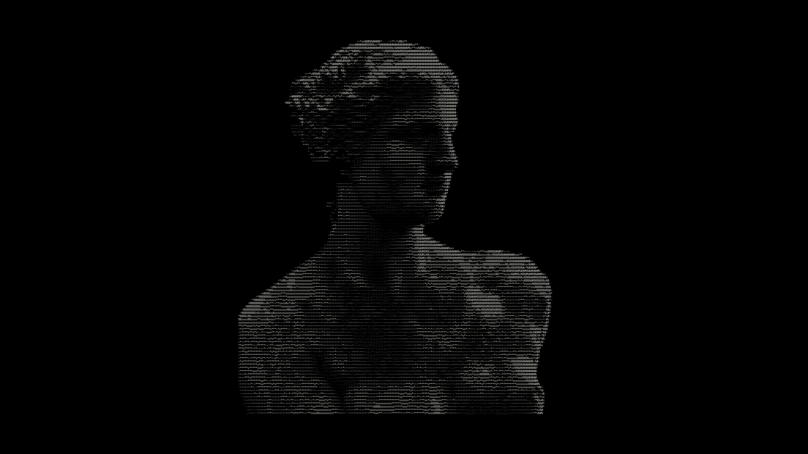
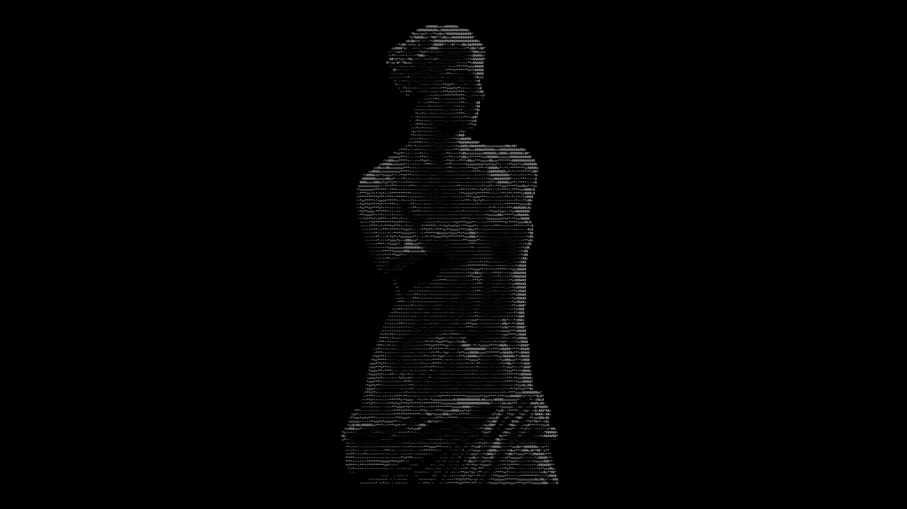
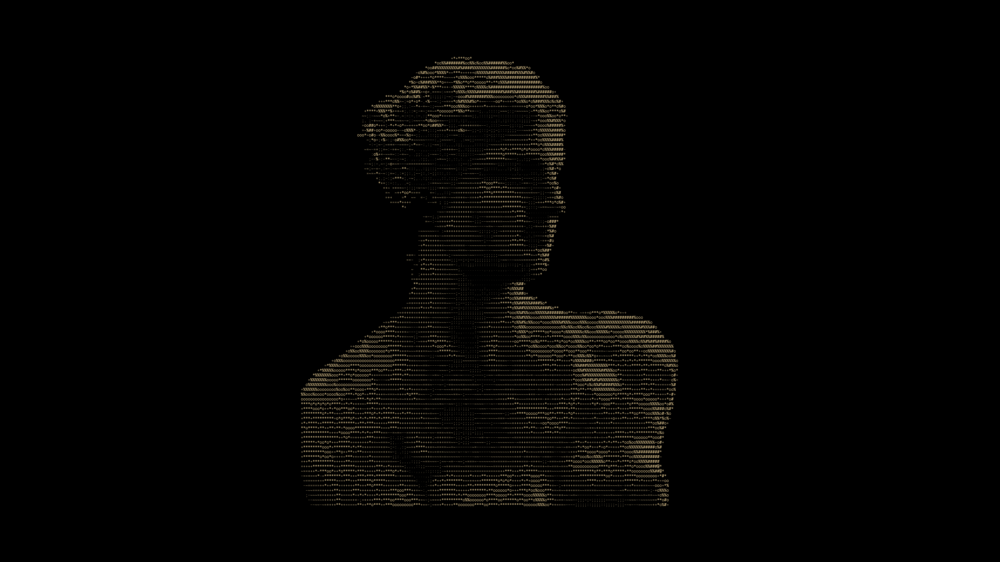
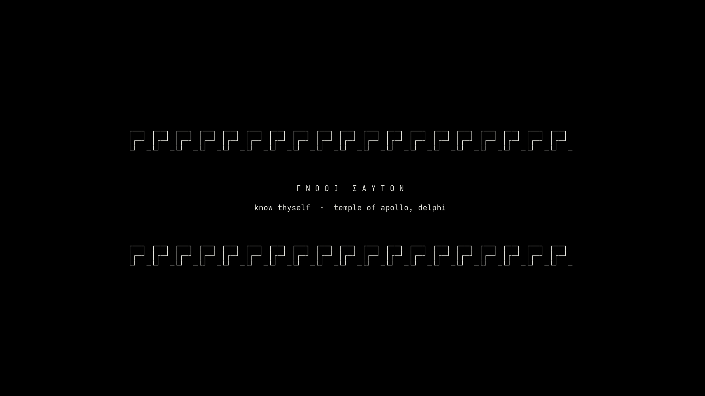
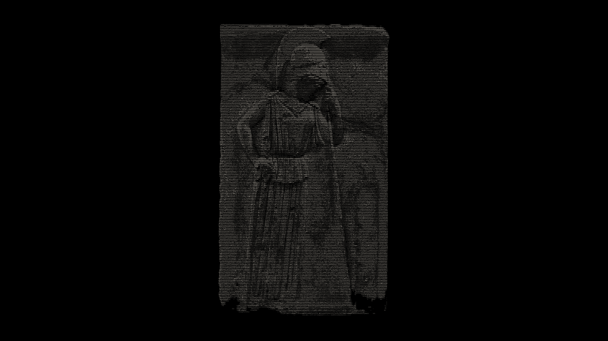

<div align="center">

```
   ▄▀█ █▀ █▀▀ █ █   █ █ █ ▄▀█ █   █   █▀
   █▀█ ▄█ █▄▄ █ █   ▀▄▀▄▀ █▀█ █▄▄ █▄▄ ▄█
```

**ASCII & text-mode wallpapers** · made on Arch Aero OS

</div>

## Layout

| Folder | What goes there |
|---|---|
| `walls/<category>/` | Final wallpapers (PNG/JPG, ideally 2560×1440 or larger) |
| `art/<category>/` | The ASCII source of each wallpaper (`.txt`), same name as the image |
| `palettes/` | Color palettes used to render the art |
| `scripts/` | Tools that turn `art/*.txt` into `walls/*.png` |
| `preview/` | Small previews for this README |

Categories: `abstract` · `nature` · `space` · `city` · `characters` · `minimal` · `retro` · `mythology`

`mythology` is organised by goddess (`walls/mythology/<goddess>/`) and every piece comes in two 4K versions:
`*-desktop.png` 3840×2160 and `*-mobile.png` 2160×3840.

## Gallery

| | |
|---|---|
|  |  |
|  |  |

### Mythology: Greek goddesses in real statues

100 statues, reliefs and figurines of 17 goddesses (Eris, Athena, Aphrodite, Artemis, Hera, Demeter,
Hestia, Persephone, Nike, Tyche, Hygieia, Themis, Eos, Hebe, Selene, Hecate, Nemesis), raw and
ultra-detailed, in 4K for desktop and phone. Full catalog with name, artist, date, material, where each
piece is and the photo credits: [art/mythology/README.md](art/mythology/README.md).

| | | |
|---|---|---|
|  |  |  |



## Make your own

```bash
# a statue photo -> 2560x1440 OLED wallpaper, each character in its own marble tone
python3 scripts/render.py statue photo.jpg walls/characters/name.png --box 0.18,0,0.82,0.5 --cols 210 --txt art/characters/name.txt
# a photo -> raw ultra-detailed ASCII, 4K desktop (3840x2160) + 4K mobile (2160x3840)
python3 scripts/raw.py photo.jpg name --dir walls/mythology/athena --txt-dir art/mythology/athena [--box x0,y0,x1,y1]
# the whole goddess collection (list + photos from deusas-baixar) -> walls/mythology + catalog
python3 scripts/mythology.py
# plain text art -> wallpaper
python3 scripts/render.py text art/minimal/name.txt walls/minimal/name.png
```
Needs python-gobject, python-cairo and a mono font (JetBrains Mono).

## Use

Browse it straight from **Settings → Theme → Wallpaper** on Arch Aero OS (add this repository as a collection),
or grab any file from `walls/`.

## Sources

The `mythology` pieces are generated from photos on Wikimedia Commons; each one is credited, with its
license, in [art/mythology/README.md](art/mythology/README.md), and the wall keeps that license.

The Venus de Milo pieces are generated from a public-domain photo of the statue in the Louvre
([Wikimedia Commons](https://commons.wikimedia.org/wiki/File:Venus_de_Milo_Louvre_Ma399_n4.jpg)).

## License

Original art in this repository: [CC BY 4.0](https://creativecommons.org/licenses/by/4.0/), except the `mythology`
walls, which follow the license of their source photo (see the catalog).
