# Mythology: Greek goddesses in real statues

Raw, ultra-detailed ASCII of real statues, reliefs and figurines of the Greek goddesses (and their
Roman counterparts), each one in two 4K versions: **desktop** 3840×2160 and **mobile** 2160×3840,
on pure black. The text of every wall is in `art/mythology/<goddess>/`.

Made with `scripts/raw.py` (one photo) and `scripts/mythology.py` (the whole collection).

**License:** each wall is a derivative of the photo listed next to it and keeps that photo's license
(CC BY-SA photos give CC BY-SA walls); credit the photographer as shown when you share one.

## Eris

*Goddess of discord (Discordia).*

| Wall | Work | Where | Photo |
|---|---|---|---|
| [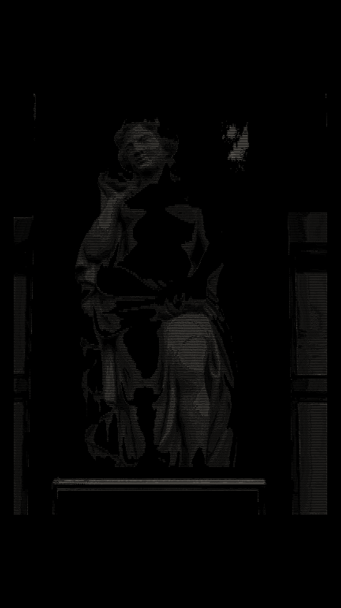](../../walls/mythology/eris/eris-com-a-maca-da-discordia-mobile.png) [desktop](../../walls/mythology/eris/eris-com-a-maca-da-discordia-desktop.png) · [mobile](../../walls/mythology/eris/eris-com-a-maca-da-discordia-mobile.png) | **Eris com a maçã da discórdia** desconhecido · 1910 · pedra | Fachada da loja Jedynak, rua Gdańska 15, Bydgoszcz, Polônia | Pit1233 CC0 · [Commons](https://commons.wikimedia.org/wiki/File:Bdg_Gdanska15_Eris_07-2013.jpg) |
| [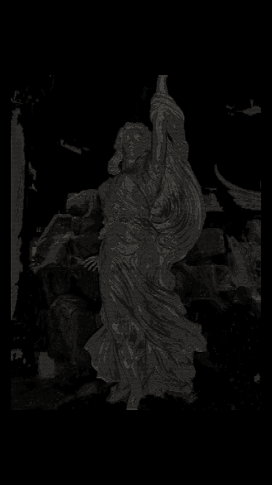](../../walls/mythology/eris/eris-com-a-maca-dourada-mobile.png) [desktop](../../walls/mythology/eris/eris-com-a-maca-dourada-desktop.png) · [mobile](../../walls/mythology/eris/eris-com-a-maca-dourada-mobile.png) | **Eris com a maçã dourada** desconhecido · séc. XX | Fonte dos Deuses, Forum Shops, Caesars Palace, Las Vegas, Estados Unidos [Wikidata](https://www.wikidata.org/wiki/Q61584000) | Jim G from Silicon Valley, CA, USA CC BY 2.0 · [Commons](https://commons.wikimedia.org/wiki/File:DSC33156,_Caesar%E2%80%99s_Palace_Hotel_and_Casino,_Las_Vegas,_Nevada,_USA_(6995324547).jpg) |
| [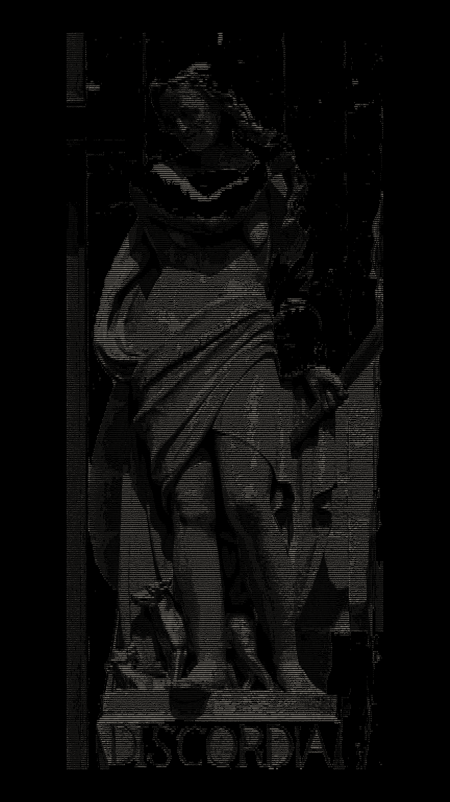](../../walls/mythology/eris/discordia-discordia-longe-mobile.png) [desktop](../../walls/mythology/eris/discordia-discordia-longe-desktop.png) · [mobile](../../walls/mythology/eris/discordia-discordia-longe-mobile.png) | **Discórdia (Discordia Longe)** desconhecido · c. 1696 · pedra | Fachada da Maison de la Louve, Grand-Place, Bruxelas, Bélgica | iMahesh CC BY-SA 4.0 · [Commons](https://commons.wikimedia.org/wiki/File:Maison_de_la_Louve_(Brussels)_-_Detail_of_the_statue_of_Discord_(Discordia).jpg) |
| [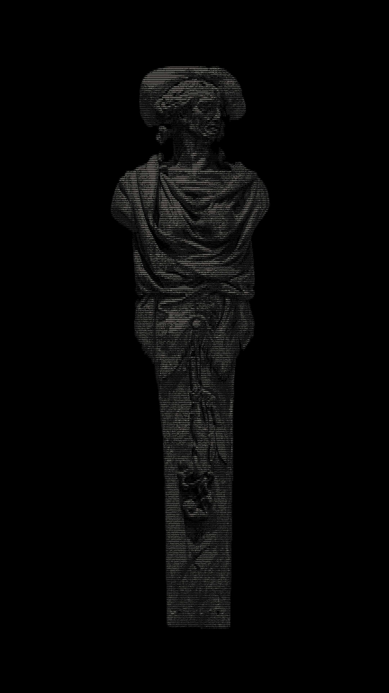](../../walls/mythology/eris/a-discordia-mobile.png) [desktop](../../walls/mythology/eris/a-discordia-desktop.png) · [mobile](../../walls/mythology/eris/a-discordia-mobile.png) | **A Discórdia** Ambroise Frédeau · séc. XVII | Musée des Augustins (RA 878 A), Toulouse, França [Wikidata](https://www.wikidata.org/wiki/Q21532087) | Didier Descouens Public domain · [Commons](https://commons.wikimedia.org/wiki/File:Augustins_-_La_Discorde_-_Ambroise_Fr%C3%A9deau_-_RA_878_A.jpg) |
| [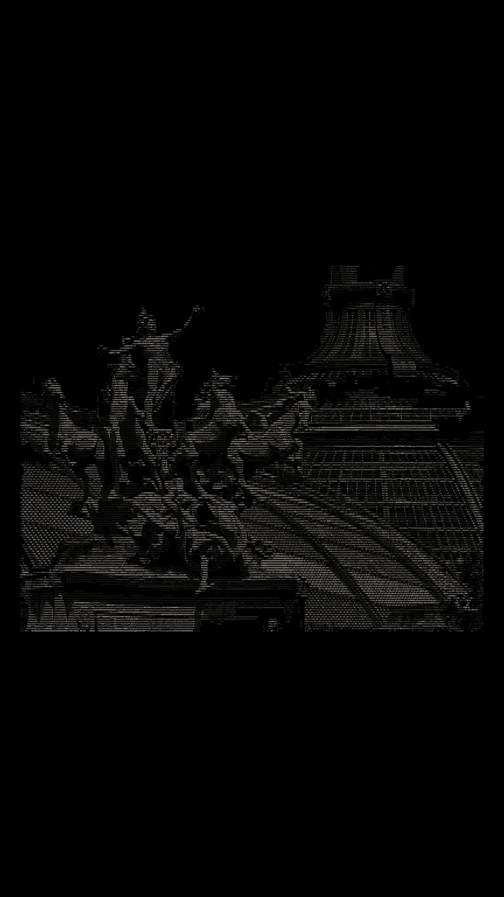](../../walls/mythology/eris/a-harmonia-triunfando-sobre-a-discordia-mobile.png) [desktop](../../walls/mythology/eris/a-harmonia-triunfando-sobre-a-discordia-desktop.png) · [mobile](../../walls/mythology/eris/a-harmonia-triunfando-sobre-a-discordia-mobile.png) | **A Harmonia triunfando sobre a Discórdia** Georges Récipon · 1900 · bronze | Grand Palais, entrada sul, Paris, França [Wikidata](https://www.wikidata.org/wiki/Q18168655) | Eutouring CC BY-SA 4.0 · [Commons](https://commons.wikimedia.org/wiki/File:L%27Harmonie_Triomphant_de_la_Discorde_statue.JPG) |
| [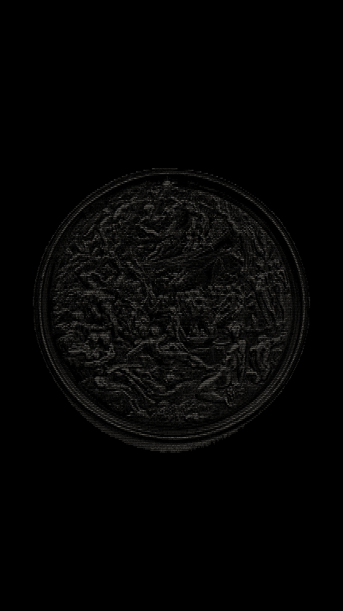](../../walls/mythology/eris/placa-das-bodas-de-peleu-e-tetis-eris-chega-sem-convite-mobile.png) [desktop](../../walls/mythology/eris/placa-das-bodas-de-peleu-e-tetis-eris-chega-sem-convite-desktop.png) · [mobile](../../walls/mythology/eris/placa-das-bodas-de-peleu-e-tetis-eris-chega-sem-convite-mobile.png) | **Placa das bodas de Peleu e Tétis (Eris chega sem convite)** Adam van Vianen, segundo Abraham Bloemaert · séc. XVII · bronze | Walters Art Museum, Baltimore, Estados Unidos | Adam van Vianen / After Abraham Bloemaert Public domain · [Commons](https://commons.wikimedia.org/wiki/File:Adam_van_Vianen_-_Plaque_with_the_Wedding_of_Peleus_and_Thetis_-_Walters_542399.jpg) |

## Athena

*Goddess of wisdom and war (Minerva).*

| Wall | Work | Where | Photo |
|---|---|---|---|
| [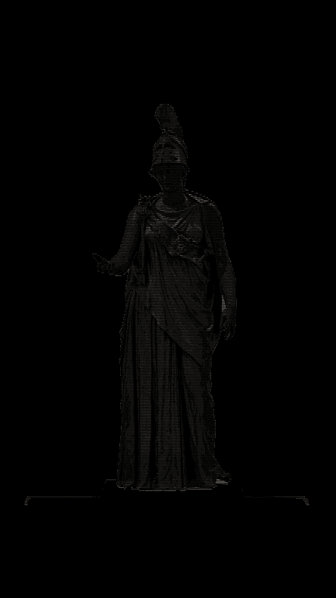](../../walls/mythology/athena/atena-do-pireu-mobile.png) [desktop](../../walls/mythology/athena/atena-do-pireu-desktop.png) · [mobile](../../walls/mythology/athena/atena-do-pireu-mobile.png) | **Atena do Pireu** desconhecido · c. 360 a.C. · bronze | Museu Arqueológico do Pireu, Pireu, Grécia [Wikidata](https://www.wikidata.org/wiki/Q17105272) | Nikos Kitsakis CC BY 4.0 · [Commons](https://commons.wikimedia.org/wiki/File:Piraeus_Athena_Full_View_Front.jpg) |
| [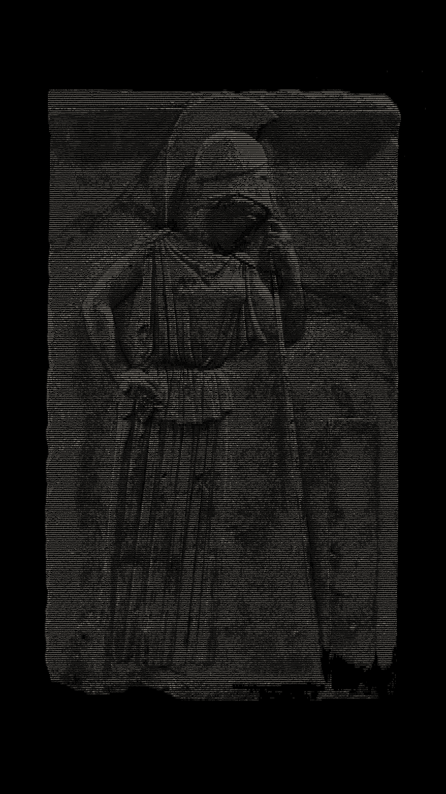](../../walls/mythology/athena/atena-pensativa-atena-em-luto-mobile.png) [desktop](../../walls/mythology/athena/atena-pensativa-atena-em-luto-desktop.png) · [mobile](../../walls/mythology/athena/atena-pensativa-atena-em-luto-mobile.png) | **Atena Pensativa (Atena em luto)** desconhecido · c. 460 a.C. · mármore de Paros | Museu da Acrópole, Atenas, Grécia [Wikidata](https://www.wikidata.org/wiki/Q3558923) | Nikos Kitsakis CC BY 4.0 · [Commons](https://commons.wikimedia.org/wiki/File:Pensive_Athena_in_Acropolis_Museum_2024.jpg) |
| [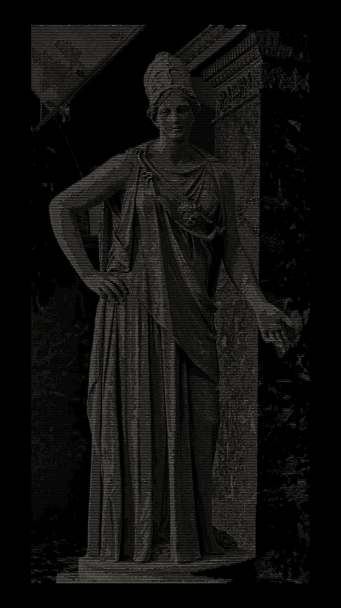](../../walls/mythology/athena/atena-mattei-mobile.png) [desktop](../../walls/mythology/athena/atena-mattei-desktop.png) · [mobile](../../walls/mythology/athena/atena-mattei-mobile.png) | **Atena Mattei** desconhecido (cópia romana de original grego) · séc. I–II · mármore | Museu do Louvre (Ma 530), Paris, França [Wikidata](https://www.wikidata.org/wiki/Q18667700) | Jastrow Public domain · [Commons](https://commons.wikimedia.org/wiki/File:Mattei_Athena_Louvre_Ma530_n2.jpg) |
| [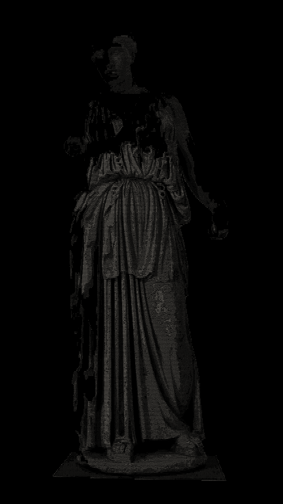](../../walls/mythology/athena/atena-com-a-egide-cruzada-mobile.png) [desktop](../../walls/mythology/athena/atena-com-a-egide-cruzada-desktop.png) · [mobile](../../walls/mythology/athena/atena-com-a-egide-cruzada-mobile.png) | **Atena com a égide cruzada** desconhecido · c. 150 a.C. · mármore | Antikensammlung (Coleção de Antiguidades), Berlim, Alemanha [Wikidata](https://www.wikidata.org/wiki/Q755224) | Anagoria CC BY 3.0 · [Commons](https://commons.wikimedia.org/wiki/File:Athena_Kreuzbandaegis_anagoria.JPG) |
| [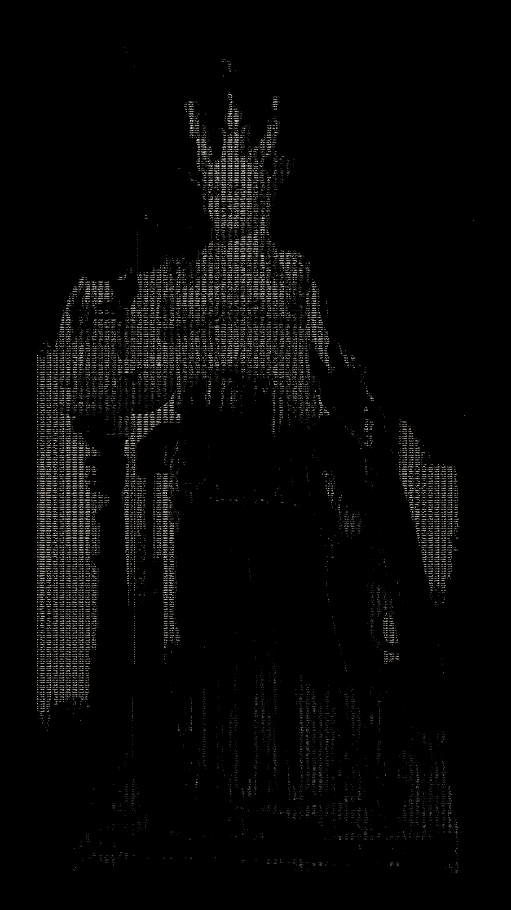](../../walls/mythology/athena/atena-varvakeion-mobile.png) [desktop](../../walls/mythology/athena/atena-varvakeion-desktop.png) · [mobile](../../walls/mythology/athena/atena-varvakeion-mobile.png) | **Atena Varvakeion** desconhecido (cópia romana da Atena Partenos de Fídias) · séc. III · mármore pentélico | Museu Arqueológico Nacional, Atenas, Grécia [Wikidata](https://www.wikidata.org/wiki/Q25221697) | Unknown (After Phidias' Athena Parthenos) CC BY 2.5 · [Commons](https://commons.wikimedia.org/wiki/File:NAMA_Ath%C3%A9na_Varvakeion.jpg) |
| [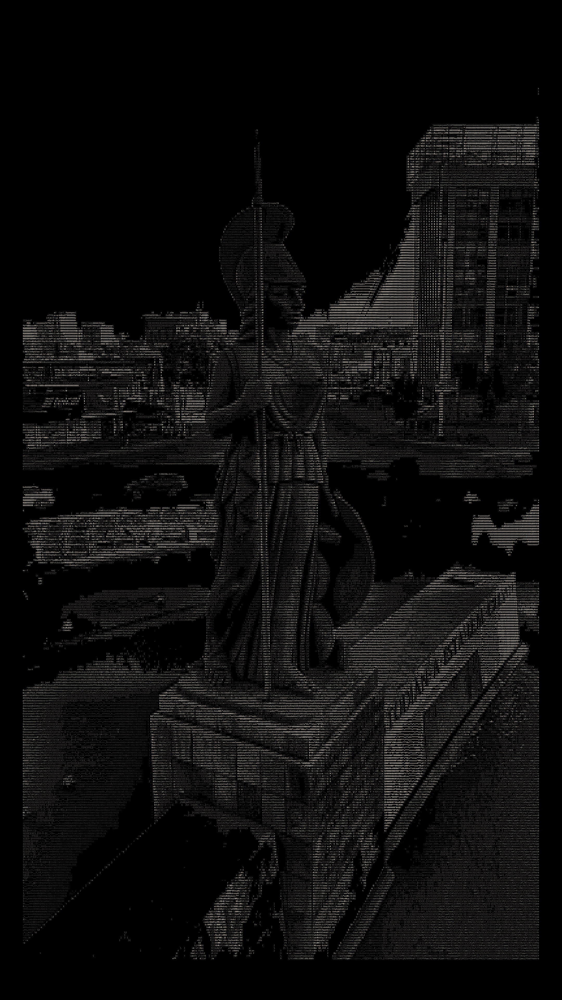](../../walls/mythology/athena/minerva-glorieta-la-minerva-mobile.png) [desktop](../../walls/mythology/athena/minerva-glorieta-la-minerva-desktop.png) · [mobile](../../walls/mythology/athena/minerva-glorieta-la-minerva-mobile.png) | **Minerva (Glorieta La Minerva)** Joaquín Arias · 1956–57 · bronze | Glorieta La Minerva, Guadalajara, México [Wikidata](https://www.wikidata.org/wiki/Q5964364) | ProtoplasmaKid CC BY-SA 4.0 · [Commons](https://commons.wikimedia.org/wiki/File:Glorieta_La_Minerva_01.jpg) |

## Aphrodite

*Goddess of love and beauty (Venus).*

| Wall | Work | Where | Photo |
|---|---|---|---|
| [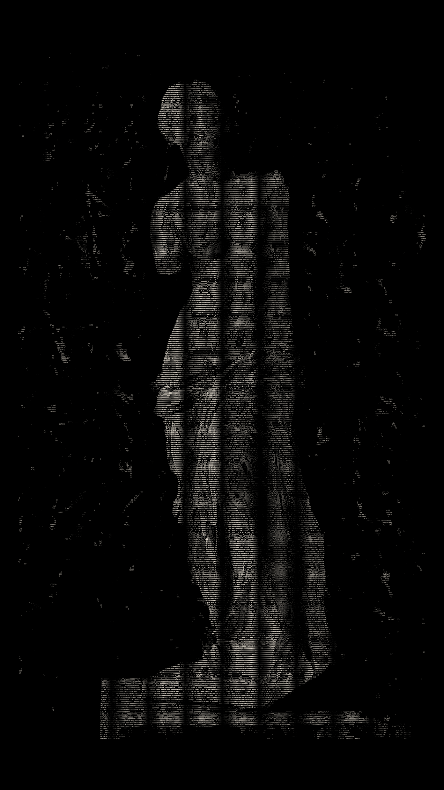](../../walls/mythology/aphrodite/venus-de-milo-mobile.png) [desktop](../../walls/mythology/aphrodite/venus-de-milo-desktop.png) · [mobile](../../walls/mythology/aphrodite/venus-de-milo-mobile.png) | **Vênus de Milo** Alexandros de Antioquia · c. 150–125 a.C. · mármore de Paros | Museu do Louvre (Ma 399), Paris, França [Wikidata](https://www.wikidata.org/wiki/Q151952) | Shonagon CC0 · [Commons](https://commons.wikimedia.org/wiki/File:V%C3%A9nus_de_Milo_-_Mus%C3%A9e_du_Louvre_AGER_LL_299_;_N_527_;_Ma_399.jpg) |
| [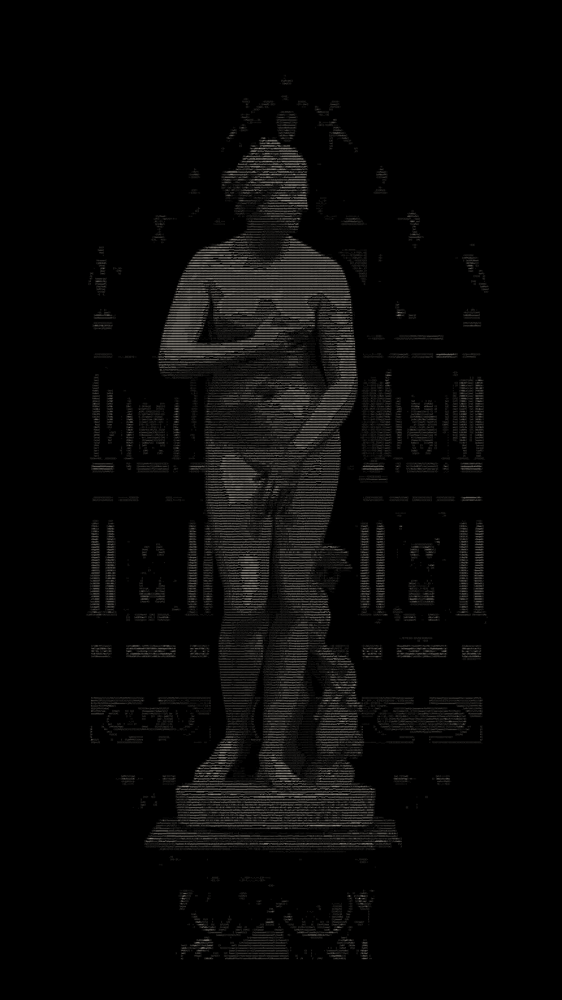](../../walls/mythology/aphrodite/venus-de-medici-mobile.png) [desktop](../../walls/mythology/aphrodite/venus-de-medici-desktop.png) · [mobile](../../walls/mythology/aphrodite/venus-de-medici-mobile.png) | **Vênus de Médici** Cleômenes (atribuída) · séc. I a.C. · mármore | Galeria Uffizi, Florença, Itália [Wikidata](https://www.wikidata.org/wiki/Q774967) | Sailko CC BY 3.0 · [Commons](https://commons.wikimedia.org/wiki/File:Cleomene_di_Apollodoro,_venere_medici,_I_secolo_ac_ca.jpg) |
| [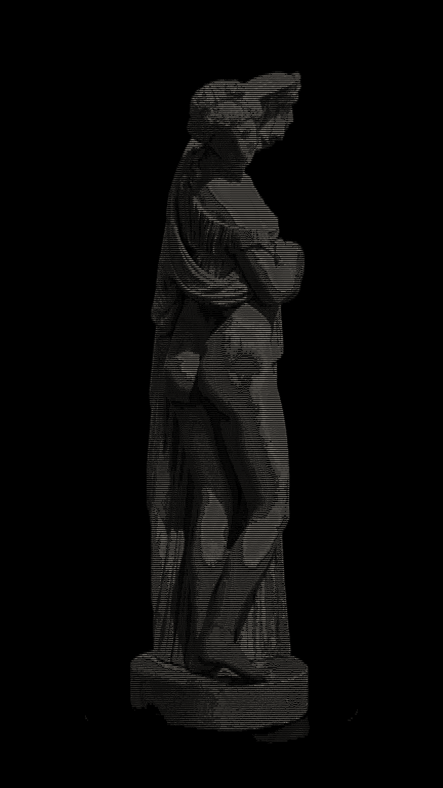](../../walls/mythology/aphrodite/venus-calipigia-mobile.png) [desktop](../../walls/mythology/aphrodite/venus-calipigia-desktop.png) · [mobile](../../walls/mythology/aphrodite/venus-calipigia-mobile.png) | **Vênus Calipígia** desconhecido · séc. II · mármore | Museu Arqueológico Nacional, Nápoles, Itália [Wikidata](https://www.wikidata.org/wiki/Q618521) | Sailko CC BY 3.0 · [Commons](https://commons.wikimedia.org/wiki/File:Arte_romana,_afrodite_callipigia,_II_secolo_dc._(mann)_01.jpg) |
| [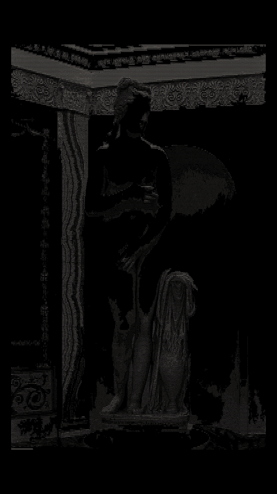](../../walls/mythology/aphrodite/venus-capitolina-mobile.png) [desktop](../../walls/mythology/aphrodite/venus-capitolina-desktop.png) · [mobile](../../walls/mythology/aphrodite/venus-capitolina-mobile.png) | **Vênus Capitolina** desconhecido · séc. II · mármore | Museus Capitolinos (Palazzo Nuovo), Roma, Itália [Wikidata](https://www.wikidata.org/wiki/Q1728619) | José Luiz CC BY-SA 4.0 · [Commons](https://commons.wikimedia.org/wiki/File:Capitoline_Venus_-_Palazzo_Nuovo_-_Musei_Capitolini_-_Rome_2016.jpg) |
| [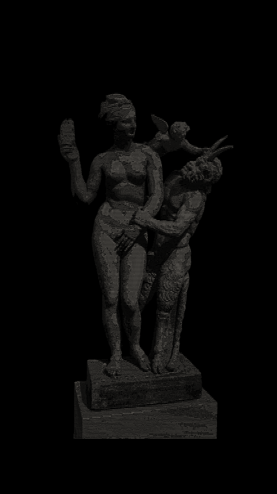](../../walls/mythology/aphrodite/afrodite-pa-e-eros-mobile.png) [desktop](../../walls/mythology/aphrodite/afrodite-pa-e-eros-desktop.png) · [mobile](../../walls/mythology/aphrodite/afrodite-pa-e-eros-mobile.png) | **Afrodite, Pã e Eros** desconhecido · c. 100 a.C. · mármore de Paros | Museu Arqueológico Nacional, Atenas, Grécia [Wikidata](https://www.wikidata.org/wiki/Q1550994) | Jebulon CC0 · [Commons](https://commons.wikimedia.org/wiki/File:Aphrodite_Pan_Eros_NAMA_3335_Athens_Greece.jpg) |
| [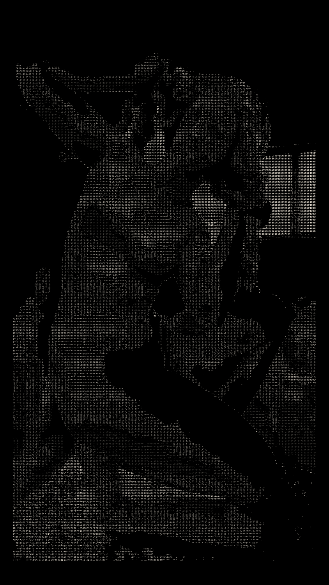](../../walls/mythology/aphrodite/afrodite-agachada-de-rodes-mobile.png) [desktop](../../walls/mythology/aphrodite/afrodite-agachada-de-rodes-desktop.png) · [mobile](../../walls/mythology/aphrodite/afrodite-agachada-de-rodes-mobile.png) | **Afrodite Agachada de Rodes** desconhecido · séc. I a.C. · mármore de Paros | Museu Arqueológico de Rodes, Rodes, Grécia [Wikidata](https://www.wikidata.org/wiki/Q12877546) | Burkhard Mücke CC BY-SA 4.0 · [Commons](https://commons.wikimedia.org/wiki/File:2023-09-18_Crouching_Venus_in_Rhodes.jpg) |

## Artemis

*Goddess of the hunt and the moon (Diana).*

| Wall | Work | Where | Photo |
|---|---|---|---|
| [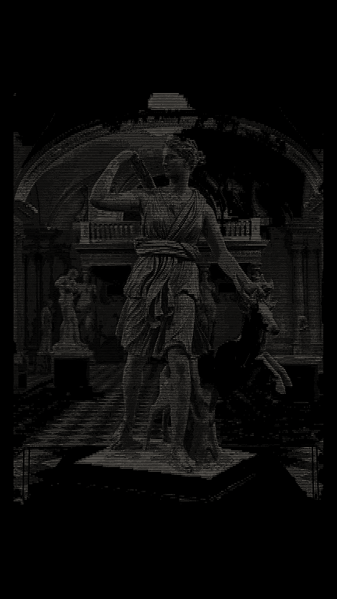](../../walls/mythology/artemis/diana-de-versalhes-mobile.png) [desktop](../../walls/mythology/artemis/diana-de-versalhes-desktop.png) · [mobile](../../walls/mythology/artemis/diana-de-versalhes-mobile.png) | **Diana de Versalhes** desconhecido (cópia romana de Leocares) · séc. I–II · mármore | Museu do Louvre (Ma 589), Paris, França [Wikidata](https://www.wikidata.org/wiki/Q2584518) | Shonagon CC0 · [Commons](https://commons.wikimedia.org/wiki/File:Diane_de_Versailles_-_Mus%C3%A9e_du_Louvre_AGER_Ma_589.jpg) |
| [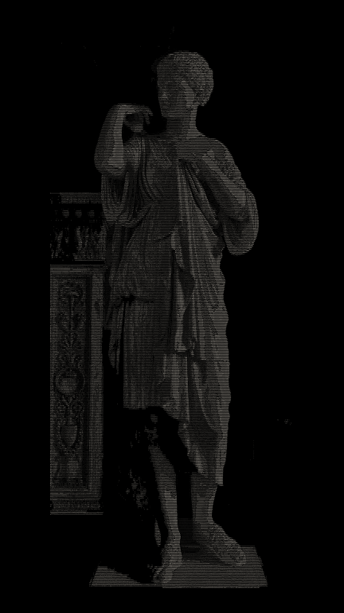](../../walls/mythology/artemis/diana-de-gabios-mobile.png) [desktop](../../walls/mythology/artemis/diana-de-gabios-desktop.png) · [mobile](../../walls/mythology/artemis/diana-de-gabios-mobile.png) | **Diana de Gábios** Praxíteles (cópia romana) · séc. I · mármore | Museu do Louvre (Ma 529), Paris, França [Wikidata](https://www.wikidata.org/wiki/Q3026255) | Copy after Praxiteles? CC BY 2.5 · [Commons](https://commons.wikimedia.org/wiki/File:Artemis_Gabii_Louvre_Ma529_n1.jpg) |
| [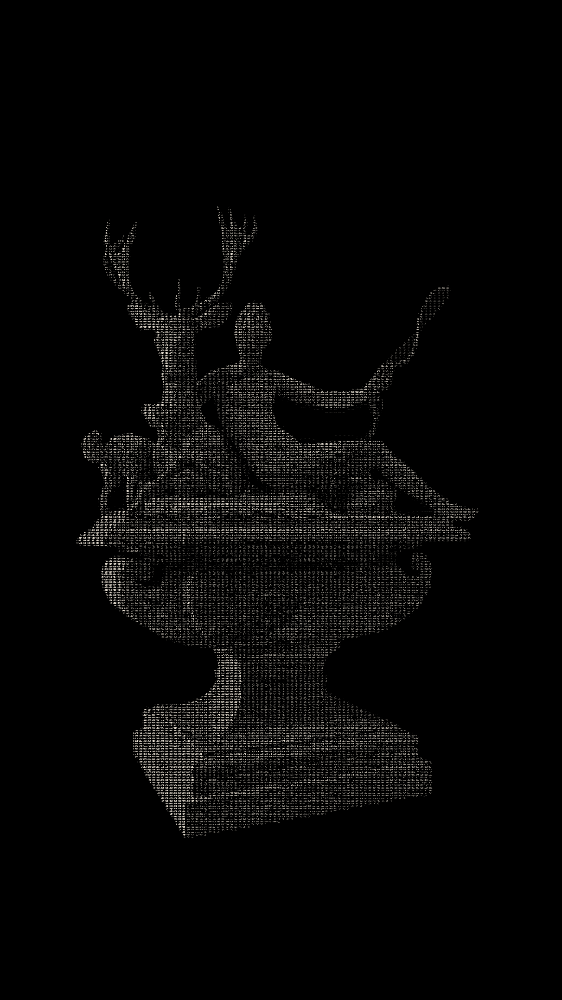](../../walls/mythology/artemis/fonte-de-diana-de-anet-mobile.png) [desktop](../../walls/mythology/artemis/fonte-de-diana-de-anet-desktop.png) · [mobile](../../walls/mythology/artemis/fonte-de-diana-de-anet-mobile.png) | **Fonte de Diana (de Anet)** Jean Goujon (atribuída) · c. 1550 · mármore | Museu do Louvre, vindo do Castelo de Anet, Paris, França [Wikidata](https://www.wikidata.org/wiki/Q19359137) | Jebulon Public domain · [Commons](https://commons.wikimedia.org/wiki/File:Fontaine_Diane_Fountain_Diana_Anet_Louvre_MR_1581,_MR_sup_123.jpg) |
| [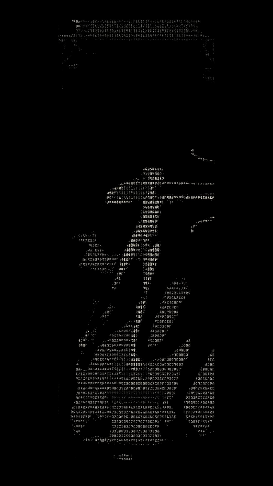](../../walls/mythology/artemis/diana-mobile.png) [desktop](../../walls/mythology/artemis/diana-desktop.png) · [mobile](../../walls/mythology/artemis/diana-mobile.png) | **Diana** Augustus Saint-Gaudens · 1892–93 · cobre dourado | Philadelphia Museum of Art, Filadélfia, Estados Unidos [Wikidata](https://www.wikidata.org/wiki/Q5271070) | Augustus Saint-Gaudens CC BY-SA 3.0 · [Commons](https://commons.wikimedia.org/wiki/File:Diana_of_the_Tower_Philadelphia_Museum_of_Art_cropped.jpg) |
| [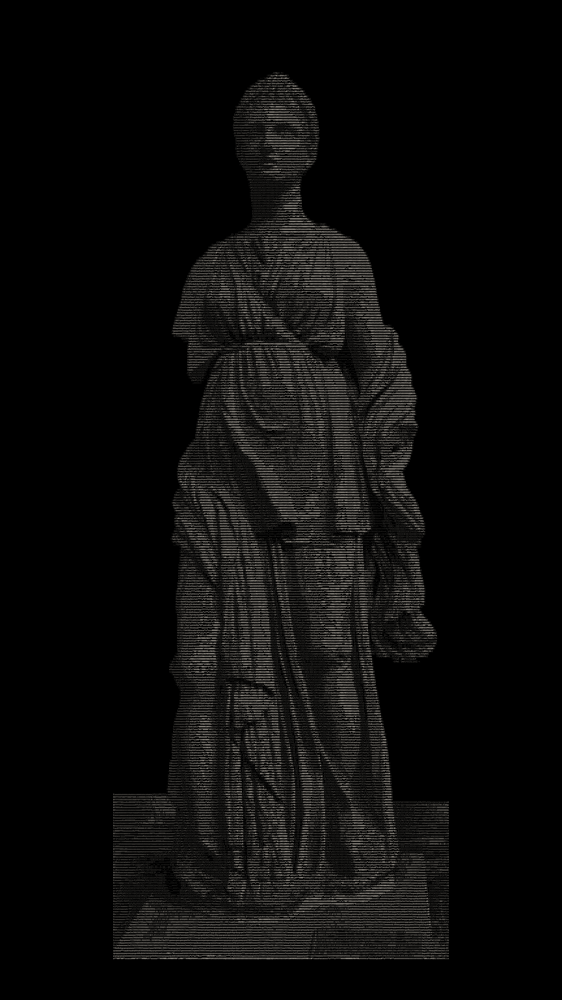](../../walls/mythology/artemis/artemis-diadumena-mobile.png) [desktop](../../walls/mythology/artemis/artemis-diadumena-desktop.png) · [mobile](../../walls/mythology/artemis/artemis-diadumena-mobile.png) | **Ártemis Diadumena** desconhecido · séc. II · mármore de Paros | Museu Arqueológico Nacional, Atenas, Grécia [Wikidata](https://www.wikidata.org/wiki/Q1582643) | Mathesis at Italian Wikipedia CC BY 3.0 · [Commons](https://commons.wikimedia.org/wiki/File:Artemide.jpg) |
| [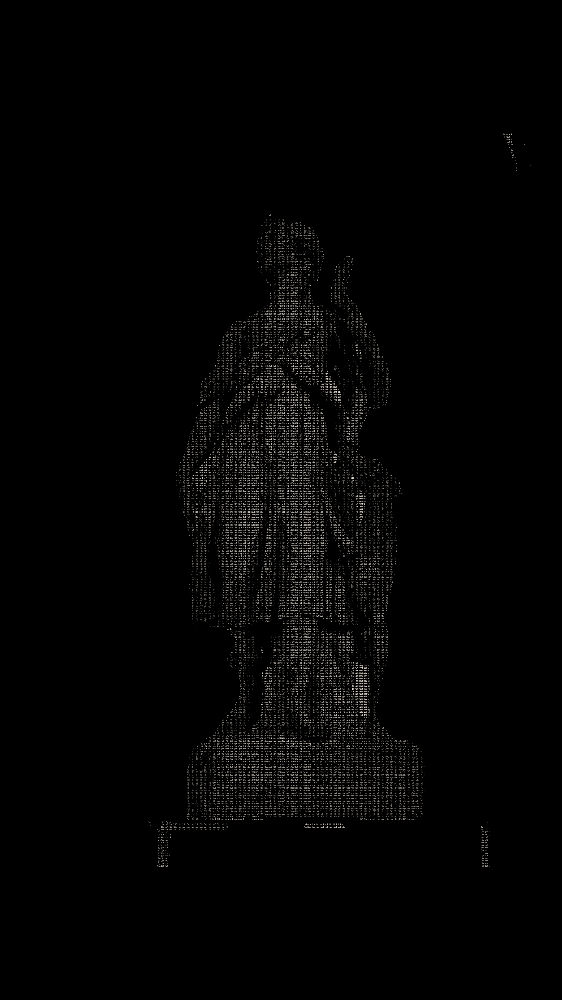](../../walls/mythology/artemis/diana-da-orangerie-de-kew-mobile.png) [desktop](../../walls/mythology/artemis/diana-da-orangerie-de-kew-desktop.png) · [mobile](../../walls/mythology/artemis/diana-da-orangerie-de-kew-mobile.png) | **Diana da Orangerie de Kew** desconhecido · pedra | Orangerie, Royal Botanic Gardens (acervo do Victoria and Albert Museum), Londres, Reino Unido [Wikidata](https://www.wikidata.org/wiki/Q126690105) | Photograph by Mike Peel (www.mikepeel.net). CC BY-SA 4.0 · [Commons](https://commons.wikimedia.org/wiki/File:At_Royal_Botanic_Gardens,_Kew_2024_070.jpg) |

## Hera

*Goddess of queen of the gods (Juno).*

| Wall | Work | Where | Photo |
|---|---|---|---|
| [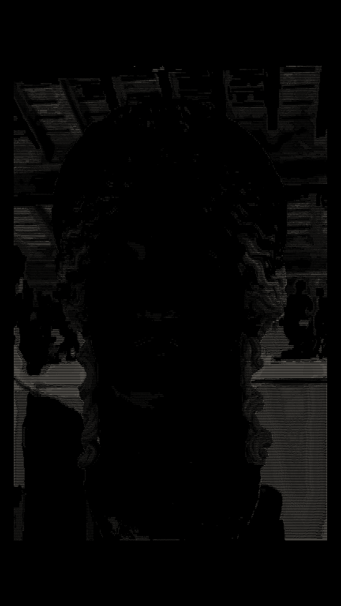](../../walls/mythology/hera/juno-ludovisi-mobile.png) [desktop](../../walls/mythology/hera/juno-ludovisi-desktop.png) · [mobile](../../walls/mythology/hera/juno-ludovisi-mobile.png) | **Juno Ludovisi** desconhecido · séc. I · mármore | Museu Nacional Romano (Palazzo Altemps), Roma, Itália [Wikidata](https://www.wikidata.org/wiki/Q1102166) |  Public domain · [Commons](https://commons.wikimedia.org/wiki/File:Hera_Ludovisi_Altemps_Inv8631.jpg) |
| [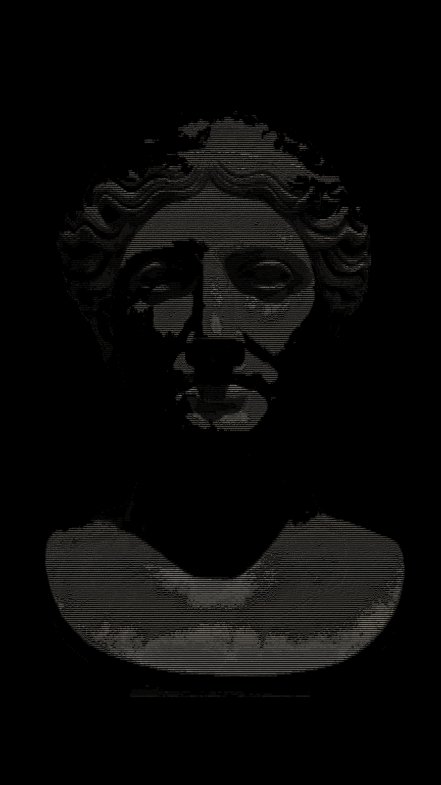](../../walls/mythology/hera/hera-farnese-mobile.png) [desktop](../../walls/mythology/hera/hera-farnese-desktop.png) · [mobile](../../walls/mythology/hera/hera-farnese-mobile.png) | **Hera Farnese** desconhecido (cópia romana de original grego) · séc. I–II · mármore | Museu Arqueológico Nacional (inv. 6005), Nápoles, Itália [Wikidata](https://www.wikidata.org/wiki/Q2252969) |  CC BY 2.5 · [Commons](https://commons.wikimedia.org/wiki/File:Artemis_Ariccia_MAN_Napoli_Inv6005.jpg) |
| [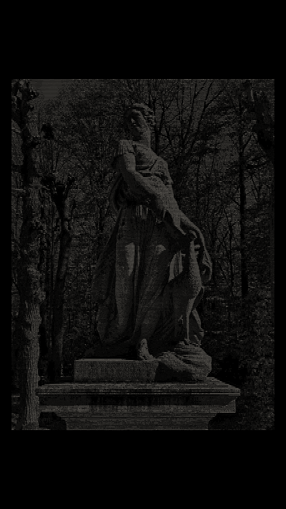](../../walls/mythology/hera/juno-com-o-pavao-de-pe-mobile.png) [desktop](../../walls/mythology/hera/juno-com-o-pavao-de-pe-desktop.png) · [mobile](../../walls/mythology/hera/juno-com-o-pavao-de-pe-mobile.png) | **Juno com o pavão de pé** desconhecido · séc. XVIII · arenito | Jardim barroco de Großsedlitz, Heidenau, Alemanha [Wikidata](https://www.wikidata.org/wiki/Q140198492) | Rigorius CC BY-SA 4.0 · [Commons](https://commons.wikimedia.org/wiki/File:Gro%C3%9Fsedlitz_Barockgarten_Juno-Pfau-stehend_20260501_162251.jpg) |
| [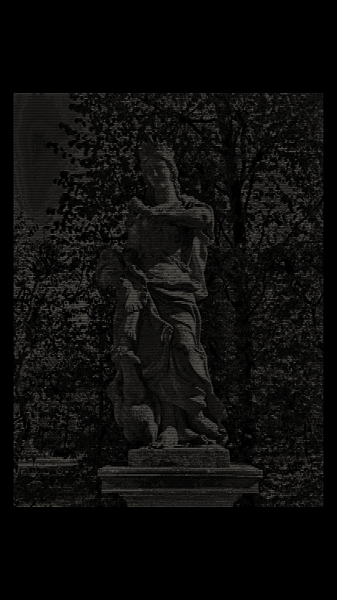](../../walls/mythology/hera/juno-com-o-pavao-sentado-mobile.png) [desktop](../../walls/mythology/hera/juno-com-o-pavao-sentado-desktop.png) · [mobile](../../walls/mythology/hera/juno-com-o-pavao-sentado-mobile.png) | **Juno com o pavão sentado** desconhecido · séc. XVIII · arenito | Jardim barroco de Großsedlitz, Heidenau, Alemanha [Wikidata](https://www.wikidata.org/wiki/Q140030542) | Rigorius CC BY-SA 4.0 · [Commons](https://commons.wikimedia.org/wiki/File:Gro%C3%9Fsedlitz_Barockgarten_Juno-Pfau_sitzend_20260501_161215.jpg) |
| [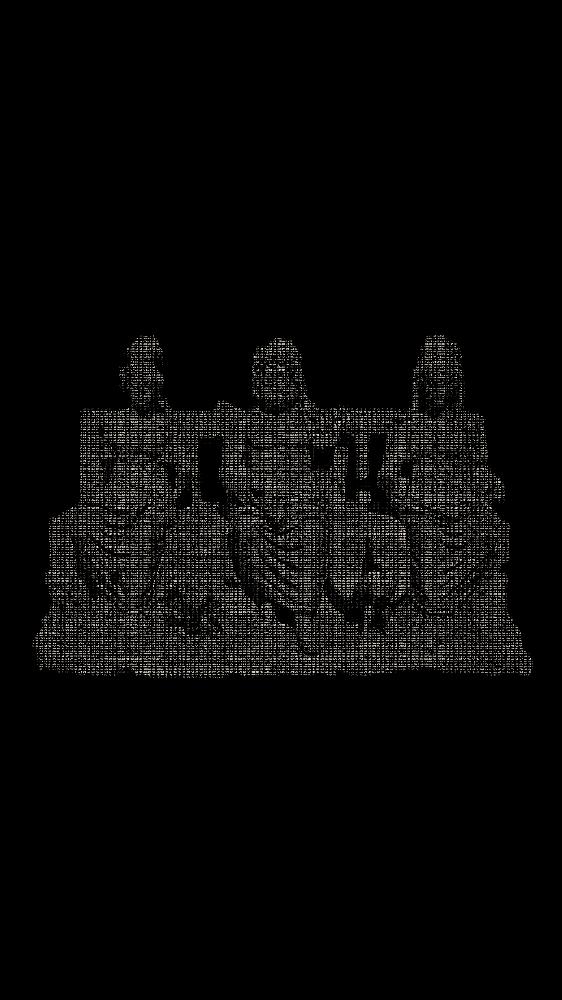](../../walls/mythology/hera/triade-capitolina-jupiter-juno-e-minerva-mobile.png) [desktop](../../walls/mythology/hera/triade-capitolina-jupiter-juno-e-minerva-desktop.png) · [mobile](../../walls/mythology/hera/triade-capitolina-jupiter-juno-e-minerva-mobile.png) | **Tríade Capitolina (Júpiter, Juno e Minerva)** desconhecido · 160–180 · mármore de Carrara | Museo Civico Archeologico, Guidonia Montecelio, Itália [Wikidata](https://www.wikidata.org/wiki/Q94952200) | Sailko CC BY 3.0 · [Commons](https://commons.wikimedia.org/wiki/File:Arte_romana,_triade_capitolina,_160-180_dc_(guidonia_montecelio,_museo_civico_archeologico)_01.jpg) |
| [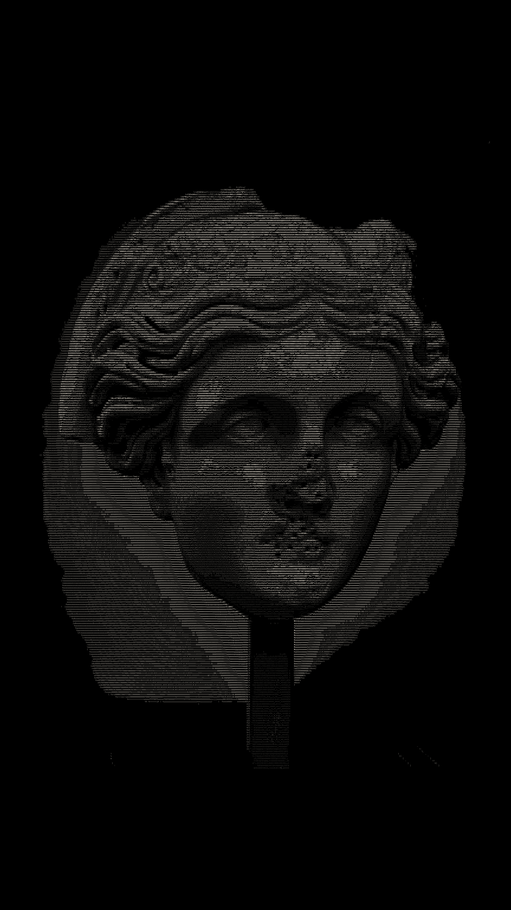](../../walls/mythology/hera/juno-ra-51-bis-mobile.png) [desktop](../../walls/mythology/hera/juno-ra-51-bis-desktop.png) · [mobile](../../walls/mythology/hera/juno-ra-51-bis-mobile.png) | **Juno (?) Ra 51 bis** desconhecido · séc. III · mármore de Saint-Béat | Musée Saint-Raymond, Toulouse, França [Wikidata](https://www.wikidata.org/wiki/Q27926279) | Daniel Martin CC BY-SA 4.0 · [Commons](https://commons.wikimedia.org/wiki/File:MSR-ra-51bis-1-DM.jpg) |

## Demeter

*Goddess of the harvest (Ceres).*

| Wall | Work | Where | Photo |
|---|---|---|---|
| [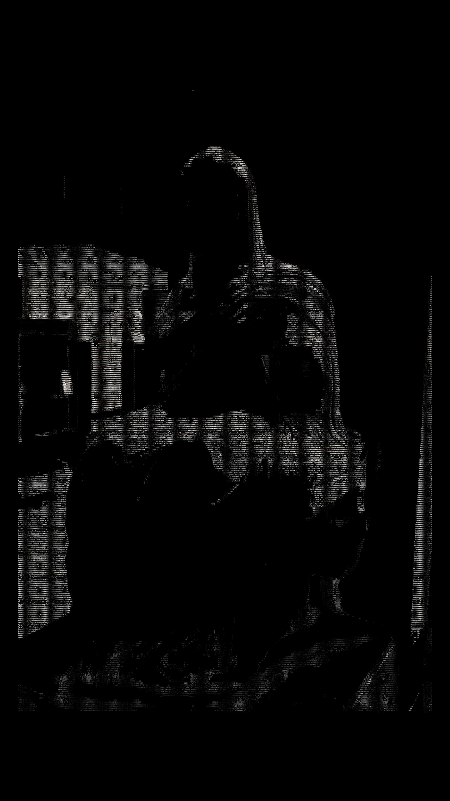](../../walls/mythology/demeter/demeter-de-cnido-mobile.png) [desktop](../../walls/mythology/demeter/demeter-de-cnido-desktop.png) · [mobile](../../walls/mythology/demeter/demeter-de-cnido-mobile.png) | **Deméter de Cnido** desconhecido · c. 350 a.C. · mármore | Museu Britânico, Londres, Reino Unido [Wikidata](https://www.wikidata.org/wiki/Q16988597) | Raymond.ellis CC0 · [Commons](https://commons.wikimedia.org/wiki/File:Marble_Statue_of_Demeter.jpg) |
| [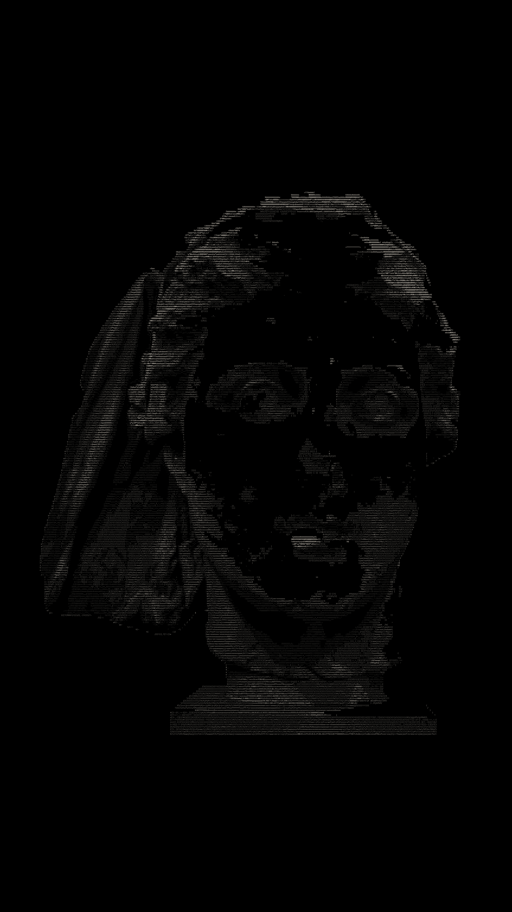](../../walls/mythology/demeter/demeter-de-licosura-cabeca-colossal-mobile.png) [desktop](../../walls/mythology/demeter/demeter-de-licosura-cabeca-colossal-desktop.png) · [mobile](../../walls/mythology/demeter/demeter-de-licosura-cabeca-colossal-mobile.png) | **Deméter de Licosura (cabeça colossal)** Damofonte · c. 190–180 a.C. · mármore | Museu Arqueológico Nacional, Atenas, Grécia [Wikidata](https://www.wikidata.org/wiki/Q122909162) | Francesco Bini CC BY-SA 4.0 · [Commons](https://commons.wikimedia.org/wiki/File:Gruppo_cultuale_del_tempio_di_despina_a_lykosoura,_190-180_ac_ca.,_testa_di_demetra,_n._1734.jpg) |
| [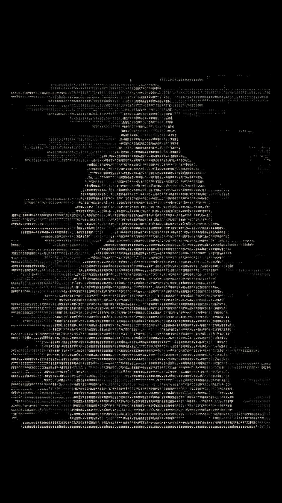](../../walls/mythology/demeter/ceres-de-merida-mobile.png) [desktop](../../walls/mythology/demeter/ceres-de-merida-desktop.png) · [mobile](../../walls/mythology/demeter/ceres-de-merida-mobile.png) | **Ceres de Mérida** desconhecido · séc. I · mármore | Museu Nacional de Arte Romana (do Teatro Romano), Mérida, Espanha [Wikidata](https://www.wikidata.org/wiki/Q138712765) | José Luis Filpo Cabana CC BY-SA 4.0 · [Commons](https://commons.wikimedia.org/wiki/File:Ceres,_Teatro_Romano_de_M%C3%A9rida.jpg) |
| [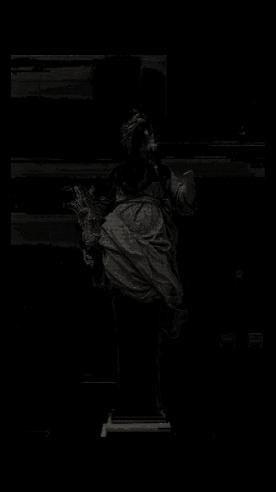](../../walls/mythology/demeter/ceres-o-verao-mobile.png) [desktop](../../walls/mythology/demeter/ceres-o-verao-desktop.png) · [mobile](../../walls/mythology/demeter/ceres-o-verao-mobile.png) | **Ceres (O Verão)** Coustou · séc. XVIII · mármore | Museu do Louvre, Paris, França [Wikidata](https://www.wikidata.org/wiki/Q21280437) | Guillaume Coustou the Elder CC BY-SA 4.0 · [Commons](https://commons.wikimedia.org/wiki/File:Coustou_-_L%27%C3%A9t%C3%A9_(Louvre_MR_1915)_01.jpg) |
| [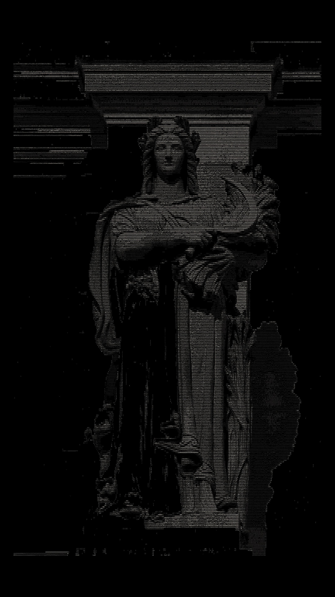](../../walls/mythology/demeter/ceres-da-union-station-mobile.png) [desktop](../../walls/mythology/demeter/ceres-da-union-station-desktop.png) · [mobile](../../walls/mythology/demeter/ceres-da-union-station-mobile.png) | **Ceres da Union Station** Louis Saint-Gaudens · 1908 · granito | Union Station, Washington, D.C., Estados Unidos [Wikidata](https://www.wikidata.org/wiki/Q34920041) | Carol M. Highsmith Public domain · [Commons](https://commons.wikimedia.org/wiki/File:Union_Station_statue,_Ceres,_Washington,_D.C_LCCN2010630343.tif) |
| [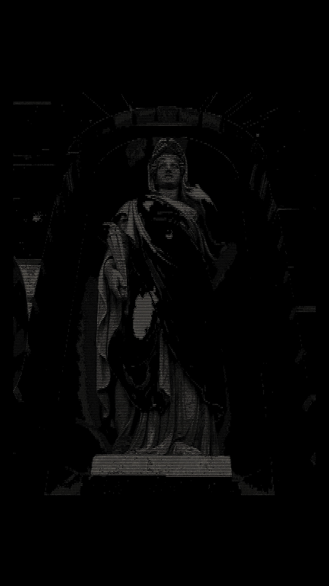](../../walls/mythology/demeter/ceres-da-porta-venezia-mobile.png) [desktop](../../walls/mythology/demeter/ceres-da-porta-venezia-desktop.png) · [mobile](../../walls/mythology/demeter/ceres-da-porta-venezia-mobile.png) | **Ceres da Porta Venezia** Democrito Gandolfi · séc. XIX · pedra | Porta Venezia, Milão, Itália [Wikidata](https://www.wikidata.org/wiki/Q74074881) | G.dallorto Attribution · [Commons](https://commons.wikimedia.org/wiki/File:03574_-_Porta_Venezia,_Milano_-_Divinit%C3%A0_romana_-_Foto_Giovanni_Dall%27Orto_23-Jun-2007.jpg) |

## Hestia

*Goddess of hearth and home (Vesta).*

| Wall | Work | Where | Photo |
|---|---|---|---|
| [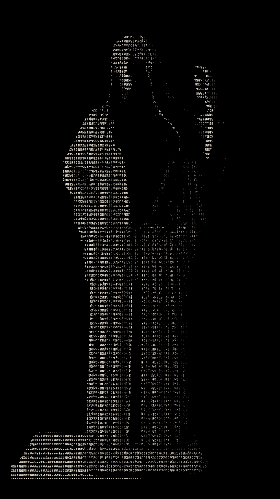](../../walls/mythology/hestia/hestia-giustiniani-mobile.png) [desktop](../../walls/mythology/hestia/hestia-giustiniani-desktop.png) · [mobile](../../walls/mythology/hestia/hestia-giustiniani-mobile.png) | **Héstia Giustiniani** desconhecido (cópia romana de original grego) · c. 120–130 · mármore de Paros | Coleção Torlonia, Roma, Itália [Wikidata](https://www.wikidata.org/wiki/Q5565558) | Marie-Lan Taÿ Pamart Public domain · [Commons](https://commons.wikimedia.org/wiki/File:Hestia_Giustiniani_Torlonia_Collection_MT490.jpg) |
| [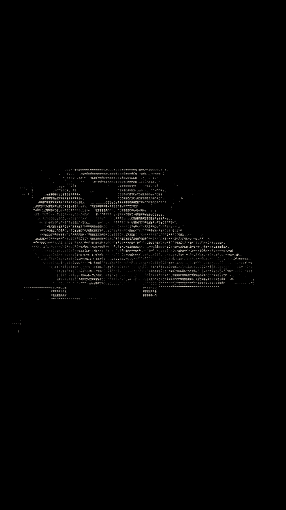](../../walls/mythology/hestia/hestia-no-frontao-leste-do-partenon-mobile.png) [desktop](../../walls/mythology/hestia/hestia-no-frontao-leste-do-partenon-desktop.png) · [mobile](../../walls/mythology/hestia/hestia-no-frontao-leste-do-partenon-mobile.png) | **Héstia no frontão leste do Partenon** Fídias (oficina) · c. 438–432 a.C. · mármore pentélico | Museu Britânico, Londres, Reino Unido | Sanjay ach CC BY-SA 4.0 · [Commons](https://commons.wikimedia.org/wiki/File:Marble_statues_of_female_figures_from_the_Parthenon_East_pediment.jpg) |
| [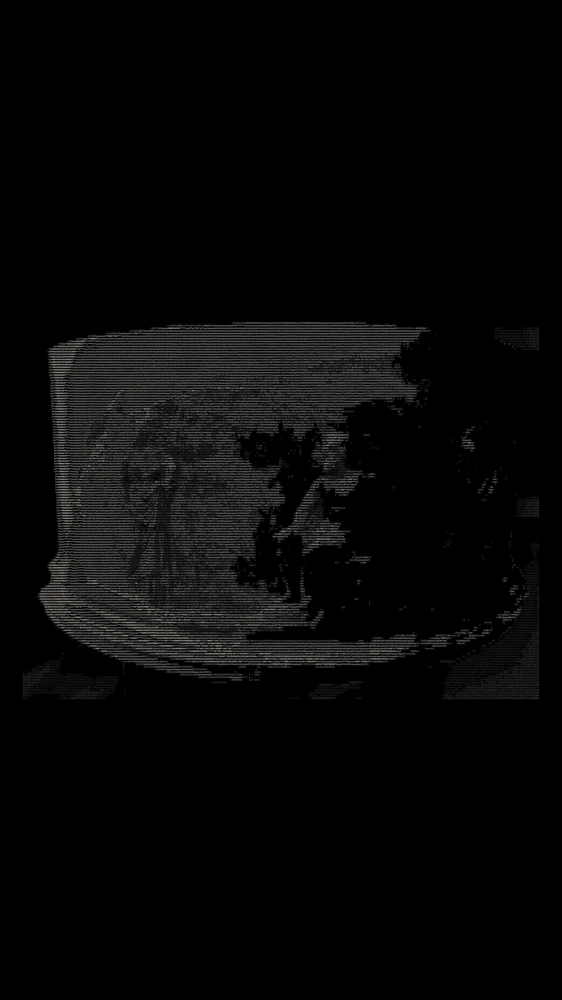](../../walls/mythology/hestia/altar-cilindrico-dos-doze-deuses-mobile.png) [desktop](../../walls/mythology/hestia/altar-cilindrico-dos-doze-deuses-desktop.png) · [mobile](../../walls/mythology/hestia/altar-cilindrico-dos-doze-deuses-mobile.png) | **Altar cilíndrico dos Doze Deuses** desconhecido · 350–340 a.C. · mármore | Museu Arqueológico Nacional (1731), Atenas, Grécia | C. de Lisle CC BY-SA 4.0 · [Commons](https://commons.wikimedia.org/wiki/File:Cylindrical_altar_of_the_twelve_gods_(Poseidon).jpg) |
| [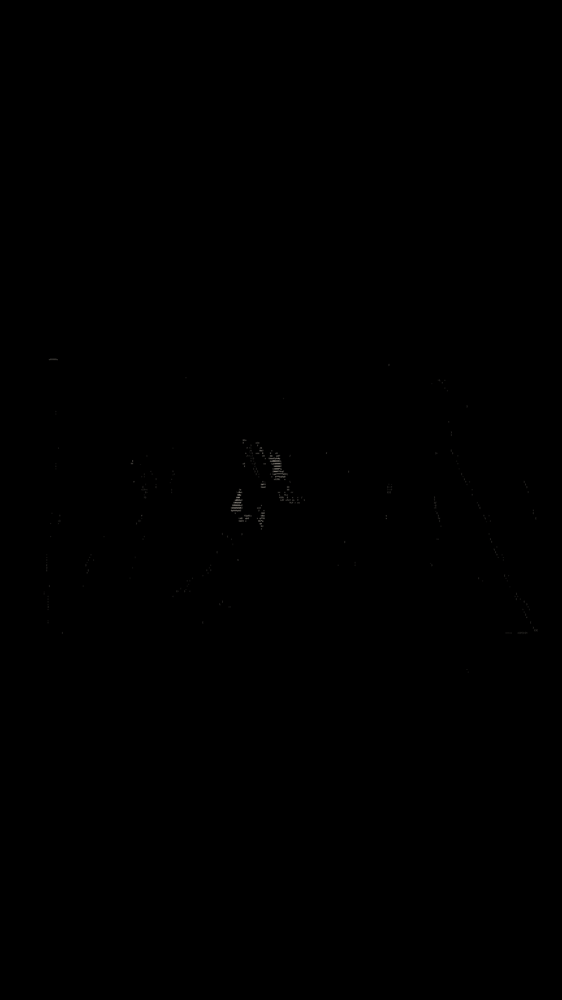](../../walls/mythology/hestia/friso-do-templo-de-atena-nike-bloco-leste-b-mobile.png) [desktop](../../walls/mythology/hestia/friso-do-templo-de-atena-nike-bloco-leste-b-desktop.png) · [mobile](../../walls/mythology/hestia/friso-do-templo-de-atena-nike-bloco-leste-b-mobile.png) | **Friso do templo de Atena Nike (bloco leste b)** desconhecido · c. 420 a.C. · mármore | Museu da Acrópole, Atenas, Grécia | Deiadameian CC BY-SA 4.0 · [Commons](https://commons.wikimedia.org/wiki/File:Blocks_from_the_frieze_of_the_Temple_of_Athena-Nike,_Acropolis_Museum_03.jpg) |
| [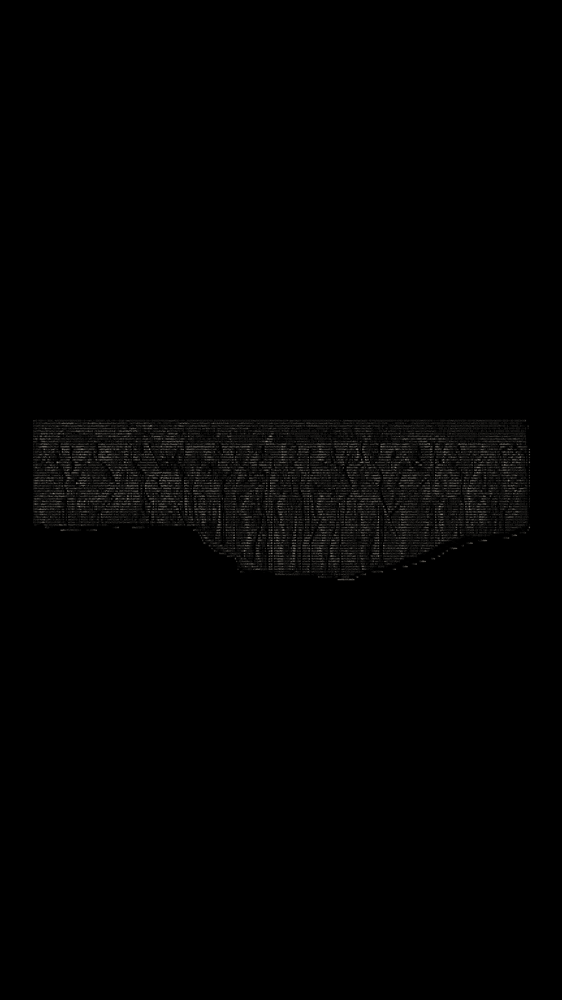](../../walls/mythology/hestia/procissao-dos-doze-deuses-relevo-mobile.png) [desktop](../../walls/mythology/hestia/procissao-dos-doze-deuses-relevo-desktop.png) · [mobile](../../walls/mythology/hestia/procissao-dos-doze-deuses-relevo-mobile.png) | **Procissão dos Doze Deuses (relevo)** desconhecido · época romana · mármore | Walters Art Museum, Baltimore, Estados Unidos | Anonymous (Greece)Unknown author Public domain · [Commons](https://commons.wikimedia.org/wiki/File:Greek_-_Procession_of_Twelve_Gods_and_Goddesses_-_Walters_2340.jpg) |

## Persephone

*Goddess of queen of the underworld (Proserpina).*

| Wall | Work | Where | Photo |
|---|---|---|---|
| [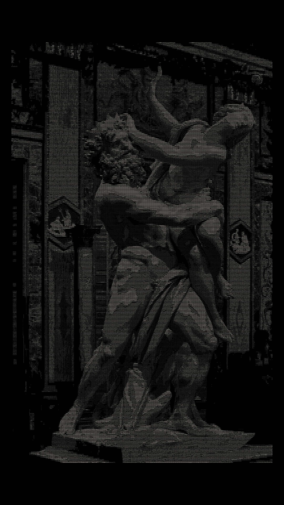](../../walls/mythology/persephone/o-rapto-de-proserpina-mobile.png) [desktop](../../walls/mythology/persephone/o-rapto-de-proserpina-desktop.png) · [mobile](../../walls/mythology/persephone/o-rapto-de-proserpina-mobile.png) | **O Rapto de Proserpina** Gian Lorenzo Bernini · 1621–22 · mármore | Galleria Borghese, Roma, Itália [Wikidata](https://www.wikidata.org/wiki/Q2352789) | Gian Lorenzo Bernini CC BY-SA 4.0 · [Commons](https://commons.wikimedia.org/wiki/File:The_Rape_of_Proserpina_(Rome).jpg) |
| [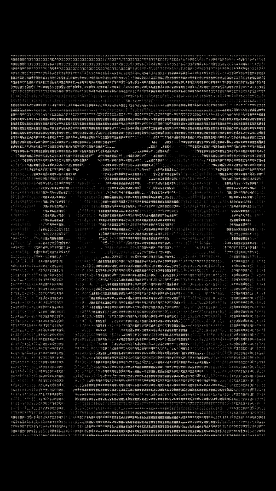](../../walls/mythology/persephone/o-rapto-de-proserpina-por-plutao-mobile.png) [desktop](../../walls/mythology/persephone/o-rapto-de-proserpina-por-plutao-desktop.png) · [mobile](../../walls/mythology/persephone/o-rapto-de-proserpina-por-plutao-mobile.png) | **O Rapto de Proserpina por Plutão** François Girardon · 1699 · mármore | Bosque da Colunata, Parque de Versalhes, Versalhes, França [Wikidata](https://www.wikidata.org/wiki/Q3054428) | Coyau CC BY-SA 3.0 · [Commons](https://commons.wikimedia.org/wiki/File:Parc_de_Versailles,_Bosquet_de_la_colonnade,_Enl%C3%A8vement_de_Proserpine_par_Pluton,_Fran%C3%A7ois_Girardon_02.jpg) |
| [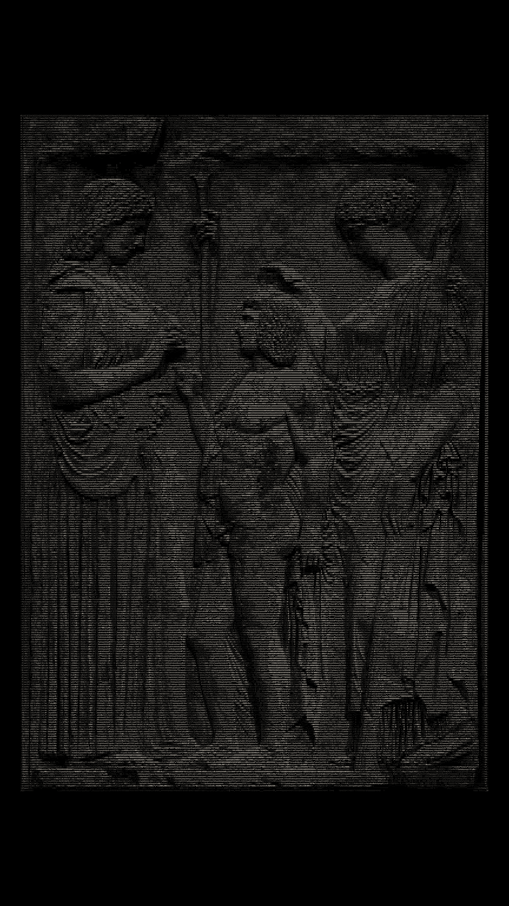](../../walls/mythology/persephone/grande-relevo-de-eleusis-demeter-triptolemo-e-persefone-mobile.png) [desktop](../../walls/mythology/persephone/grande-relevo-de-eleusis-demeter-triptolemo-e-persefone-desktop.png) · [mobile](../../walls/mythology/persephone/grande-relevo-de-eleusis-demeter-triptolemo-e-persefone-mobile.png) | **Grande Relevo de Elêusis (Deméter, Triptólemo e Perséfone)** desconhecido (cópia romana) · séc. I a.C. · mármore | Metropolitan Museum of Art (14.130.9), Nova York, Estados Unidos [Wikidata](https://www.wikidata.org/wiki/Q29383783) |  CC BY 2.5 · [Commons](https://commons.wikimedia.org/wiki/File:Great_Eleusinian_relief_fragments_Met_14.130.9_n01.jpg) |
| [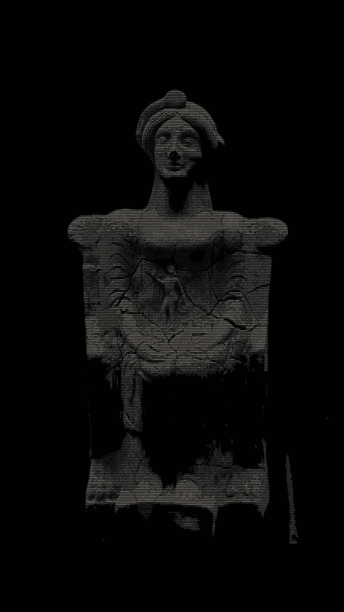](../../walls/mythology/persephone/deusa-entronizada-de-camarina-mobile.png) [desktop](../../walls/mythology/persephone/deusa-entronizada-de-camarina-desktop.png) · [mobile](../../walls/mythology/persephone/deusa-entronizada-de-camarina-mobile.png) | **Deusa entronizada de Camarina** desconhecido · c. 460 a.C. · terracota | Museu Arqueológico Regional Paolo Orsi, Siracusa, Itália [Wikidata](https://www.wikidata.org/wiki/Q131753926) | Zde CC BY-SA 4.0 · [Commons](https://commons.wikimedia.org/wiki/File:Persephone-Aphrodite,_clay,_Sicily,_460_BC,_AM_Syracuse,_121470.jpg) |
| [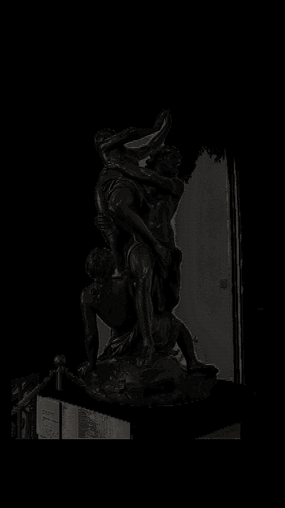](../../walls/mythology/persephone/o-rapto-de-proserpina-por-plutao-bronze-mobile.png) [desktop](../../walls/mythology/persephone/o-rapto-de-proserpina-por-plutao-bronze-desktop.png) · [mobile](../../walls/mythology/persephone/o-rapto-de-proserpina-por-plutao-bronze-mobile.png) | **O Rapto de Proserpina por Plutão (bronze)** François Girardon · 1693 · bronze | Musée des Beaux-Arts, Estrasburgo, França [Wikidata](https://www.wikidata.org/wiki/Q38522051) | Ji-Elle CC BY-SA 3.0 · [Commons](https://commons.wikimedia.org/wiki/File:Fran%C3%A7ois_Girardon-L%27Enl%C3%A8vement_de_Proserpine_(2).jpg) |
| [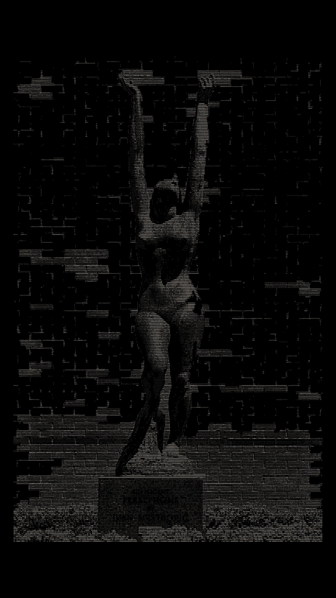](../../walls/mythology/persephone/persefone-suplicante-mobile.png) [desktop](../../walls/mythology/persephone/persefone-suplicante-desktop.png) · [mobile](../../walls/mythology/persephone/persefone-suplicante-mobile.png) | **Perséfone Suplicante** Ivan Meštrović · 1945 · bronze | Campus da Syracuse University, Syracuse (NY), Estados Unidos [Wikidata](https://www.wikidata.org/wiki/Q126456877) | DASonnenfeld CC BY-SA 4.0 · [Commons](https://commons.wikimedia.org/wiki/File:Mestrovic-Persephone-Syr-Univ.jpg) |

## Nike

*Goddess of victory (Victoria).*

| Wall | Work | Where | Photo |
|---|---|---|---|
| [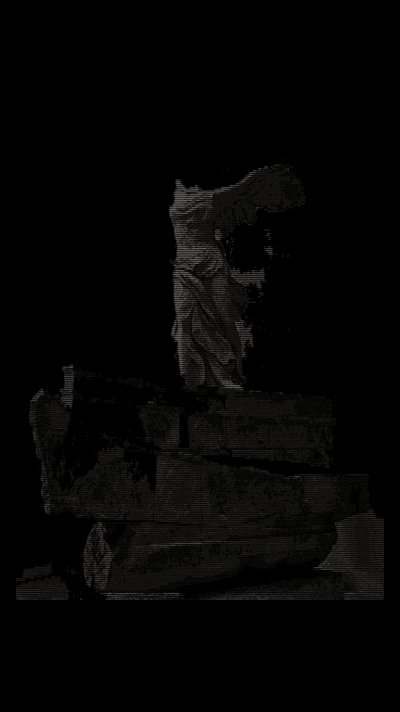](../../walls/mythology/nike/vitoria-de-samotracia-mobile.png) [desktop](../../walls/mythology/nike/vitoria-de-samotracia-desktop.png) · [mobile](../../walls/mythology/nike/vitoria-de-samotracia-mobile.png) | **Vitória de Samotrácia** Pitócrito (atribuída) · c. 190 a.C. · mármore de Paros | Museu do Louvre (Ma 2369), Paris, França [Wikidata](https://www.wikidata.org/wiki/Q216402) | Shonagon CC0 · [Commons](https://commons.wikimedia.org/wiki/File:Victoire_de_Samothrace_-_Musee_du_Louvre_-_20190812.jpg) |
| [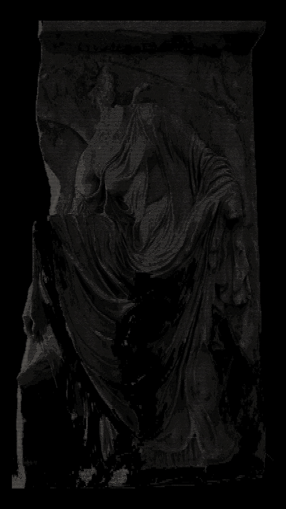](../../walls/mythology/nike/nike-desatando-a-sandalia-mobile.png) [desktop](../../walls/mythology/nike/nike-desatando-a-sandalia-desktop.png) · [mobile](../../walls/mythology/nike/nike-desatando-a-sandalia-mobile.png) | **Nike desatando a sandália** desconhecido · c. 410 a.C. · mármore | Museu da Acrópole (do templo de Atena Nike), Atenas, Grécia [Wikidata](https://www.wikidata.org/wiki/Q11792032) |  CC BY-SA 2.5 · [Commons](https://commons.wikimedia.org/wiki/File:ACMA_973_Nik%C3%A8_sandale_3.JPG) |
| [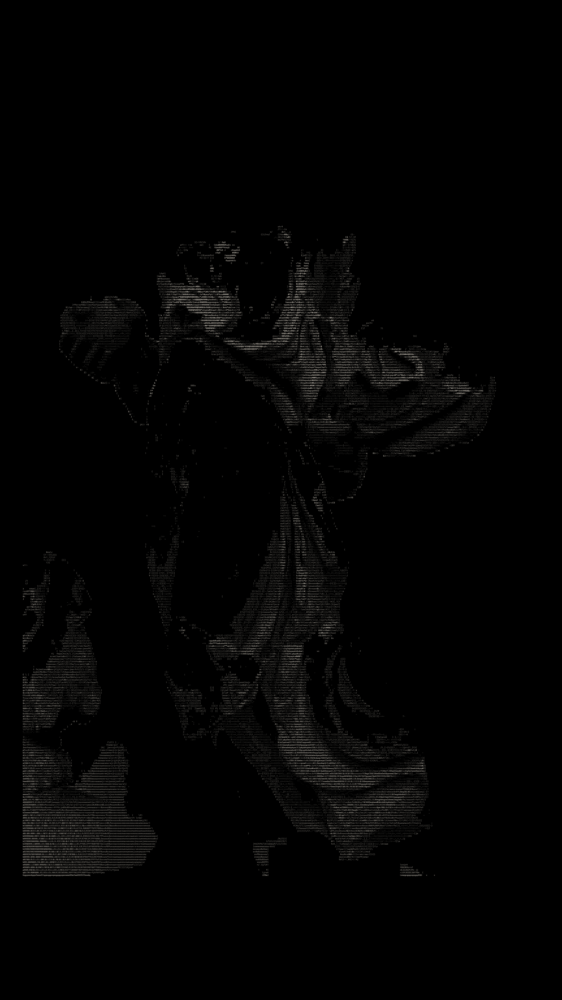](../../walls/mythology/nike/nike-de-epidauro-mobile.png) [desktop](../../walls/mythology/nike/nike-de-epidauro-desktop.png) · [mobile](../../walls/mythology/nike/nike-de-epidauro-mobile.png) | **Nike de Epidauro** Timóteo · c. 380 a.C. · mármore pentélico | Museu Arqueológico Nacional, Atenas, Grécia [Wikidata](https://www.wikidata.org/wiki/Q1990127) | Marsyas CC BY-SA 2.5 · [Commons](https://commons.wikimedia.org/wiki/File:NAMA_155_Nike_Epidauros_1.JPG) |
|  [desktop](../../walls/mythology/nike/monumento-a-sherman-com-a-vitoria-desktop.png) · [mobile](../../walls/mythology/nike/monumento-a-sherman-com-a-vitoria-mobile.png) | **Monumento a Sherman (com a Vitória)** Augustus Saint-Gaudens · 1902 · bronze dourado | Grand Army Plaza, Central Park, Nova York, Estados Unidos [Wikidata](https://www.wikidata.org/wiki/Q18159288) | Jim.henderson Public domain · [Commons](https://commons.wikimedia.org/wiki/File:Sherman_gilded_jeh.JPG) |
|  [desktop](../../walls/mythology/nike/estatueta-de-nike-desktop.png) · [mobile](../../walls/mythology/nike/estatueta-de-nike-mobile.png) | **Estatueta de Nike** desconhecido · c. 400 a.C. · mármore de Paros | Museu Arqueológico Nacional, Atenas, Grécia [Wikidata](https://www.wikidata.org/wiki/Q2334185) | Unknown artistUnknown artist CC BY-SA 2.5 · [Commons](https://commons.wikimedia.org/wiki/File:NAMA_159_Nike_Artemis_Temple_L_2.JPG) |
|  [desktop](../../walls/mythology/nike/nike-da-biblioteca-de-adriano-desktop.png) · [mobile](../../walls/mythology/nike/nike-da-biblioteca-de-adriano-mobile.png) | **Nike da Biblioteca de Adriano** desconhecido · séc. I a.C. · mármore | Biblioteca de Adriano, Atenas, Grécia [Wikidata](https://www.wikidata.org/wiki/Q124333899) | Carole Raddato from FRANKFURT, Germany CC BY-SA 2.0 · [Commons](https://commons.wikimedia.org/wiki/File:Museum_at_the_Hadrian%C2%B4s_Library,_Athens,_Greece_(14026333821).jpg) |

## Tyche

*Goddess of fortune (Fortuna).*

| Wall | Work | Where | Photo |
|---|---|---|---|
|  [desktop](../../walls/mythology/tyche/tique-de-prusias-bolu-desktop.png) · [mobile](../../walls/mythology/tyche/tique-de-prusias-bolu-mobile.png) | **Tique de Prúsias (Bolu)** desconhecido · séc. II · mármore | Museus Arqueológicos de Istambul, Istambul, Turquia [Wikidata](https://www.wikidata.org/wiki/Q137669102) | Dosseman CC BY-SA 4.0 · [Commons](https://commons.wikimedia.org/wiki/File:Istanbul_Archaeology_Museum_Tyche_personification_of_happiness_Roman_2nd_C_CE_Bolu_3703.jpg) |
|  [desktop](../../walls/mythology/tyche/fortuna-ou-tutela-mam-2735-desktop.png) · [mobile](../../walls/mythology/tyche/fortuna-ou-tutela-mam-2735-mobile.png) | **Fortuna ou Tutela (MAM 2735)** desconhecido · séc. II · cerâmica | Musée départemental de l'Arles antique, Arles, França [Wikidata](https://www.wikidata.org/wiki/Q63096970) | Rama Public domain · [Commons](https://commons.wikimedia.org/wiki/File:Fortuna_or_Tutela-MAM_2735-IMG_9179-gradient.jpg) |
|  [desktop](../../walls/mythology/tyche/fortuna-da-punta-della-dogana-desktop.png) · [mobile](../../walls/mythology/tyche/fortuna-da-punta-della-dogana-mobile.png) | **Fortuna da Punta della Dogana** Bernardo Falcone · 1678 · bronze dourado | Dogana da Mar, Veneza, Itália [Wikidata](https://www.wikidata.org/wiki/Q126842329) | Didier Descouens CC BY-SA 4.0 · [Commons](https://commons.wikimedia.org/wiki/File:Bernardo_Falconi_-_Statua_della_Fortuna_-_Punta_della_Dogana_-_Venezia.jpg) |
|  [desktop](../../walls/mythology/tyche/fortuna-de-fano-desktop.png) · [mobile](../../walls/mythology/tyche/fortuna-de-fano-mobile.png) | **Fortuna de Fano** Donnino Ambrosi · 1594 · bronze | Museo Civico (Corte Malatestiana), Fano, Itália [Wikidata](https://www.wikidata.org/wiki/Q126171251) | REminore #MPhotoGrafica CC BY-SA 4.0 · [Commons](https://commons.wikimedia.org/wiki/File:Corte_malatestiana_fano_4.jpg) |
|  [desktop](../../walls/mythology/tyche/fortuna-romana-de-fano-desktop.png) · [mobile](../../walls/mythology/tyche/fortuna-romana-de-fano-mobile.png) | **Fortuna romana de Fano** desconhecido · séc. II · mármore de Carrara | Museo Archeologico, Fano, Itália [Wikidata](https://www.wikidata.org/wiki/Q126392022) | Accurimbono CC BY-SA 4.0 · [Commons](https://commons.wikimedia.org/wiki/File:Museo_archeologico_(Fano)_120.jpg) |
|  [desktop](../../walls/mythology/tyche/fortuna-do-palacio-de-charlottenburg-desktop.png) · [mobile](../../walls/mythology/tyche/fortuna-do-palacio-de-charlottenburg-mobile.png) | **Fortuna do Palácio de Charlottenburg** Richard Scheibe · 1956 · cobre dourado | Cúpula do Palácio de Charlottenburg, Berlim, Alemanha [Wikidata](https://www.wikidata.org/wiki/Q109811717) | JoJan CC BY 3.0 · [Commons](https://commons.wikimedia.org/wiki/File:Berlin._Charlottenburg_003.JPG) |

## Hygieia

*Goddess of health (Salus).*

| Wall | Work | Where | Photo |
|---|---|---|---|
|  [desktop](../../walls/mythology/hygieia/fonte-de-higeia-desktop.png) · [mobile](../../walls/mythology/hygieia/fonte-de-higeia-mobile.png) | **Fonte de Higeia** Joseph von Kramer · 1896 · bronze | Pátio da Prefeitura (Rathaus), Hamburgo, Alemanha [Wikidata](https://www.wikidata.org/wiki/Q6063200) | Hansueli Krapf This file was uploaded with Commonist. CC BY-SA 3.0 · [Commons](https://commons.wikimedia.org/wiki/File:2013-05-24_10-18-32_Germany_Hamburg_Hamburg_Neustadt.JPG) |
|  [desktop](../../walls/mythology/hygieia/higeia-de-epidauro-desktop.png) · [mobile](../../walls/mythology/hygieia/higeia-de-epidauro-mobile.png) | **Higeia de Epidauro** Timóteo · c. 380 a.C. · mármore pentélico | Museu Arqueológico Nacional, Atenas, Grécia [Wikidata](https://www.wikidata.org/wiki/Q2334101) | Marsyas CC BY-SA 2.5 · [Commons](https://commons.wikimedia.org/wiki/File:NAMA_299_Hygieia_Epidauros_1.JPG) |
|  [desktop](../../walls/mythology/hygieia/higeia-deusa-da-saude-ra-42-desktop.png) · [mobile](../../walls/mythology/hygieia/higeia-deusa-da-saude-ra-42-mobile.png) | **Higeia, deusa da saúde (Ra 42)** desconhecido · época romana · mármore | Musée Saint-Raymond, Toulouse, França [Wikidata](https://www.wikidata.org/wiki/Q30144580) | Didier Descouens Public domain · [Commons](https://commons.wikimedia.org/wiki/File:(Toulouse)_Hygie,_d%C3%A9esse_de_la_Sant%C3%A9_-_Mus%C3%A9e_Saint-Raymond,_Ra_42.jpg) |
|  [desktop](../../walls/mythology/hygieia/higeia-de-grosedlitz-desktop.png) · [mobile](../../walls/mythology/hygieia/higeia-de-grosedlitz-mobile.png) | **Higeia de Großsedlitz** desconhecido · c. 1730 · arenito | Jardim barroco de Großsedlitz, Heidenau, Alemanha [Wikidata](https://www.wikidata.org/wiki/Q140198418) | Rigorius CC BY-SA 4.0 · [Commons](https://commons.wikimedia.org/wiki/File:Gro%C3%9Fsedlitz_Barockgarten_Hygieia_20260501_155306.jpg) |
|  [desktop](../../walls/mythology/hygieia/higeia-salus-com-hipnos-desktop.png) · [mobile](../../walls/mythology/hygieia/higeia-salus-com-hipnos-mobile.png) | **Higeia (Salus) com Hipnos** desconhecido · época romana · mármore | Getty Villa, Los Angeles, Estados Unidos [Wikidata](https://www.wikidata.org/wiki/Q124782381) | J. Paul Getty Museum CC0 · [Commons](https://commons.wikimedia.org/wiki/File:Salus,_front_-_Getty_Museum_(71.AA.338).jpg) |
|  [desktop](../../walls/mythology/hygieia/sacrificio-a-asclepio-e-higeia-relevo-desktop.png) · [mobile](../../walls/mythology/hygieia/sacrificio-a-asclepio-e-higeia-relevo-mobile.png) | **Sacrifício a Asclépio e Higeia (relevo)** desconhecido · c. 325 a.C. · mármore | Museu do Louvre (Ma 755), Paris, França [Wikidata](https://www.wikidata.org/wiki/Q118225150) | Shonagon CC0 · [Commons](https://commons.wikimedia.org/wiki/File:Sacrifice_%C3%A0_Ascl%C3%A9pios_et_Hygie_-_Mus%C3%A9e_du_Louvre_AGER_LP_2573_;_Ma_755_;_N_1743.jpg) |

## Themis

*Goddess of divine law and justice (Justitia).*

| Wall | Work | Where | Photo |
|---|---|---|---|
|  [desktop](../../walls/mythology/themis/temis-de-ramnunte-desktop.png) · [mobile](../../walls/mythology/themis/temis-de-ramnunte-mobile.png) | **Têmis de Ramnunte** Queréstrato · c. 300 a.C. · mármore | Museu Arqueológico Nacional, Atenas, Grécia [Wikidata](https://www.wikidata.org/wiki/Q24915121) | Francesco Bini CC BY-SA 4.0 · [Commons](https://commons.wikimedia.org/wiki/File:Themis,_dal_tempietto_di_nemesis_a_rhamnous,_in_attica,_scultore_chairestratos_di_ramnos,_300_ac_ca.,_n._231.jpg) |
|  [desktop](../../walls/mythology/themis/a-justica-desktop.png) · [mobile](../../walls/mythology/themis/a-justica-mobile.png) | **A Justiça** Alfredo Ceschiatti · 1961 · granito | Praça dos Três Poderes, em frente ao STF, Brasília, Brasil [Wikidata](https://www.wikidata.org/wiki/Q9557758) | Mariordo (Mario Roberto Durán Ortiz) CC BY-SA 4.0 · [Commons](https://commons.wikimedia.org/wiki/File:A_Justi%C3%A7a_escultura_BSB_08_2005_24v.jpg) |
|  [desktop](../../walls/mythology/themis/justitia-do-landgericht-desktop.png) · [mobile](../../walls/mythology/themis/justitia-do-landgericht-mobile.png) | **Justitia do Landgericht** Joseph Breitkopf-Cosel · 1905 · bronze | Landgericht Berlin, Berlim, Alemanha [Wikidata](https://www.wikidata.org/wiki/Q129409680) | Genealogist CC0 · [Commons](https://commons.wikimedia.org/wiki/File:Justitia_am_Landgericht_Berlin.JPG) |
|  [desktop](../../walls/mythology/themis/fonte-da-justitia-desktop.png) · [mobile](../../walls/mythology/themis/fonte-da-justitia-mobile.png) | **Fonte da Justitia** Carl Westman e Gustaf Sandberg · 1917 · bronze | Kungsholmen, junto ao Rådhuset, Estocolmo, Suécia [Wikidata](https://www.wikidata.org/wiki/Q10541560) | Sinikka Halme CC BY-SA 4.0 · [Commons](https://commons.wikimedia.org/wiki/File:Justitiabrunnen_Stockholm_01.jpg) |
|  [desktop](../../walls/mythology/themis/justica-do-palacio-ducal-desktop.png) · [mobile](../../walls/mythology/themis/justica-do-palacio-ducal-mobile.png) | **Justiça do Palácio Ducal** Alessandro Vittoria · 1579 · mármore | Fachada do Palácio Ducal, Veneza, Itália [Wikidata](https://www.wikidata.org/wiki/Q117814834) | Dimitris Kamaras from Athens, Greece CC BY 2.0 · [Commons](https://commons.wikimedia.org/wiki/File:Palazzo_Ducale,_Venice_(30943932285).jpg) |
|  [desktop](../../walls/mythology/themis/justica-do-portal-da-antiga-prefeitura-desktop.png) · [mobile](../../walls/mythology/themis/justica-do-portal-da-antiga-prefeitura-mobile.png) | **Justiça do portal da Antiga Prefeitura** Anton Pilgram · 1510 · pedra | Portal da Antiga Prefeitura (Stará radnice), Brno, Tchéquia [Wikidata](https://www.wikidata.org/wiki/Q131190621) | Michal Klajban CC BY-SA 3.0 · [Commons](https://commons.wikimedia.org/wiki/File:Brno,_port%C3%A1l_star%C3%A9_radnice_-_%C5%BEensk%C3%A1_postava_uprost%C5%99ed.JPG) |

## Eos

*Goddess of the dawn (Aurora).*

| Wall | Work | Where | Photo |
|---|---|---|---|
|  [desktop](../../walls/mythology/eos/aurora-de-rendsburg-desktop.png) · [mobile](../../walls/mythology/eos/aurora-de-rendsburg-mobile.png) | **Aurora de Rendsburg** Fritz Fleer · 1987 · bronze | Parque Hans-Heinemann, Rendsburg, Alemanha [Wikidata](https://www.wikidata.org/wiki/Q126811750) | Frank Vincentz CC BY-SA 3.0 · [Commons](https://commons.wikimedia.org/wiki/File:Rendsburg_-_Hans-Heinemann-Park_-_Aurora_(Fritz_Fleer)_02_ies.jpg) |
|  [desktop](../../walls/mythology/eos/eos-do-balneario-aurora-desktop.png) · [mobile](../../walls/mythology/eos/eos-do-balneario-aurora-mobile.png) | **Eos do balneário Aurora** desconhecido · madeira | Parque do balneário Aurora, Třeboň, Tchéquia [Wikidata](https://www.wikidata.org/wiki/Q109651130) | JAn Dudík CC BY-SA 4.0 · [Commons](https://commons.wikimedia.org/wiki/File:Plastika_v_parku_Aurora_2.jpg) |
|  [desktop](../../walls/mythology/eos/aurora-desktop.png) · [mobile](../../walls/mythology/eos/aurora-mobile.png) | **Aurora** Philippe Magnier · 1704 · mármore | Bosque dos Domos, Parque de Versalhes, Versalhes, França [Wikidata](https://www.wikidata.org/wiki/Q18822193) | Coyau CC BY-SA 3.0 · [Commons](https://commons.wikimedia.org/wiki/File:Parc_de_Versailles,_Bosquet_des_D%C3%B4mes,_Aurore,_Philippe_Magnier_01.jpg) |
|  [desktop](../../walls/mythology/eos/aurora-breker-desktop.png) · [mobile](../../walls/mythology/eos/aurora-breker-mobile.png) | **Aurora** Arno Breker · 1926 · bronze | Museum Kunstpalast, Düsseldorf, Alemanha [Wikidata](https://www.wikidata.org/wiki/Q113995334) | Raimond Spekking CC BY-SA 4.0 · [Commons](https://commons.wikimedia.org/wiki/File:Museum_Kunstpalast_-_Aurora_-_Arno_Breker_(8086-88).jpg) |
|  [desktop](../../walls/mythology/eos/eos-do-parque-do-castelo-desktop.png) · [mobile](../../walls/mythology/eos/eos-do-parque-do-castelo-mobile.png) | **Eos do parque do castelo** desconhecido · pedra | Parque do Castelo de Jaroměřice nad Rokytnou, Jaroměřice nad Rokytnou, Tchéquia [Wikidata](https://www.wikidata.org/wiki/Q112031468) | Jiří Sedláček CC BY-SA 4.0 · [Commons](https://commons.wikimedia.org/wiki/File:Overview_of_statue_of_Eos_in_Castle_park_in_Jarom%C4%9B%C5%99ice_nad_Rokytnou,_T%C5%99eb%C3%AD%C4%8D_District.jpg) |

## Hebe

*Goddess of youth (Juventas).*

| Wall | Work | Where | Photo |
|---|---|---|---|
|  [desktop](../../walls/mythology/hebe/hebe-desktop.png) · [mobile](../../walls/mythology/hebe/hebe-mobile.png) | **Hebe** Bertel Thorvaldsen · 1816 · mármore | Museu Thorvaldsen, Copenhague, Dinamarca [Wikidata](https://www.wikidata.org/wiki/Q21584724) | Bertel Thorvaldsen CC0 · [Commons](https://commons.wikimedia.org/wiki/File:Hebe_by_Bertel_Thorvaldsen_(A874).jpg) |
|  [desktop](../../walls/mythology/hebe/hebe-adormecida-desktop.png) · [mobile](../../walls/mythology/hebe/hebe-adormecida-mobile.png) | **Hebe adormecida** Albert-Ernest Carrier-Belleuse · 1869 · mármore | Musée d'Orsay, Paris, França [Wikidata](https://www.wikidata.org/wiki/Q19337416) | Nardac Gulliver CC BY-SA 4.0 · [Commons](https://commons.wikimedia.org/wiki/File:CB_H%C3%A9b%C3%A9.jpg) |
|  [desktop](../../walls/mythology/hebe/hebe-berruer-desktop.png) · [mobile](../../walls/mythology/hebe/hebe-berruer-mobile.png) | **Hebe** Pierre-François Berruer · 1767 · terracota | Musée des Beaux-Arts, Bordéus, França [Wikidata](https://www.wikidata.org/wiki/Q131406291) | Tylwyth Eldar CC BY-SA 4.0 · [Commons](https://commons.wikimedia.org/wiki/File:Pierre-Fran%C3%A7ois_Berruer_-_H%C3%A9b%C3%A9_01.jpg) |
|  [desktop](../../walls/mythology/hebe/hebe-e-a-aguia-de-jupiter-desktop.png) · [mobile](../../walls/mythology/hebe/hebe-e-a-aguia-de-jupiter-mobile.png) | **Hebe e a águia de Júpiter** François Rude · c. 1850 · terracota | Museu do Louvre (RF 2036 B), Paris, França [Wikidata](https://www.wikidata.org/wiki/Q121641613) | Shonagon CC0 · [Commons](https://commons.wikimedia.org/wiki/File:H%C3%A9b%C3%A9_et_l%27aigle_de_Jupiter_-_Fran%C3%A7ois_Rude_-_Mus%C3%A9e_du_Louvre_Sculptures_RF_2036_B.jpg) |
|  [desktop](../../walls/mythology/hebe/hebe-jr-desktop.png) · [mobile](../../walls/mythology/hebe/hebe-jr-mobile.png) | **Hebe** Simeon Skillin Jr. · c. 1790–1800 · madeira de pinho | Metropolitan Museum of Art, Nova York, Estados Unidos [Wikidata](https://www.wikidata.org/wiki/Q20171180) | Simeon Skillin, Jr. CC0 · [Commons](https://commons.wikimedia.org/wiki/File:Hebe_MET_APS1182.jpg) |
|  [desktop](../../walls/mythology/hebe/hebe-de-chicago-desktop.png) · [mobile](../../walls/mythology/hebe/hebe-de-chicago-mobile.png) | **Hebe de Chicago** Franz Machtl · 1893 · bronze | Chicago, Estados Unidos [Wikidata](https://www.wikidata.org/wiki/Q19337773) | JCTRambler CC BY 2.0 · [Commons](https://commons.wikimedia.org/wiki/File:Franz_Machtl%E2%80%99s_Hebe_(8120447974).jpg) |

## Selene

*Goddess of the moon (Luna).*

| Wall | Work | Where | Photo |
|---|---|---|---|
|  [desktop](../../walls/mythology/selene/selene-velada-desktop.png) · [mobile](../../walls/mythology/selene/selene-velada-mobile.png) | **Selene velada** desconhecido · séc. II · mármore | Museu de Antália, Antália, Turquia | Dosseman CC BY-SA 4.0 · [Commons](https://commons.wikimedia.org/wiki/File:Antalya_Museum_9653.jpg) |
|  [desktop](../../walls/mythology/selene/selene-desktop.png) · [mobile](../../walls/mythology/selene/selene-mobile.png) | **Selene** Joan Borrell i Nicolau · séc. XX · bronze | Avinguda de Vallcarca, Barcelona, Espanha [Wikidata](https://www.wikidata.org/wiki/Q99455357) | Enric CC BY 4.0 · [Commons](https://commons.wikimedia.org/wiki/File:385_Selene,_de_Joan_Borrell_i_Nicolau,_av._Vallcarca_-_c._Vel%C3%A1zquez_(Barcelona).jpg) |
|  [desktop](../../walls/mythology/selene/luna-mf-1317-desktop.png) · [mobile](../../walls/mythology/selene/luna-mf-1317-mobile.png) | **Luna (MF 1317)** desconhecido · época romana · mármore | Musée d'Art et d'Histoire, Genebra, Suíça [Wikidata](https://www.wikidata.org/wiki/Q55989242) | Rama CC BY-SA 3.0 fr · [Commons](https://commons.wikimedia.org/wiki/File:Luna-MAHG_MF_1317-P8050445-black.jpg) |
|  [desktop](../../walls/mythology/selene/selene-deitada-desktop.png) · [mobile](../../walls/mythology/selene/selene-deitada-mobile.png) | **Selene deitada** Antoine Bourdelle · 1917 · bronze | Musée Ingres-Bourdelle, Montauban, França | Didier Descouens Public domain · [Commons](https://commons.wikimedia.org/wiki/File:Mus%C3%A9e_Ingres-Bourdelle_-_S%C3%A9l%C3%A9n%C3%A9_couch%C3%A9e,_1917_-_Bourdelle_-_Joconde06070001193.jpg) |
|  [desktop](../../walls/mythology/selene/selene-de-silahtaraga-desktop.png) · [mobile](../../walls/mythology/selene/selene-de-silahtaraga-mobile.png) | **Selene de Silahtarağa** desconhecido · séc. II · mármore | Museus Arqueológicos de Istambul, Istambul, Turquia | Osama Shukir Muhammed Amin FRCP(Glasg) CC BY-SA 4.0 · [Commons](https://commons.wikimedia.org/wiki/File:6._Silahtara%C4%9Fa_Statuary_Group_at_the_Museum_of_Archaeology,_Istanbul,_Turkey._2nd_century_CE._This_is_one_of_the_deities.jpg) |
|  [desktop](../../walls/mythology/selene/selene-com-tocha-desktop.png) · [mobile](../../walls/mythology/selene/selene-com-tocha-mobile.png) | **Selene com tocha** desconhecido · época romana · mármore | Museo Chiaramonti, Museus Vaticanos, Vaticano, Vaticano | Darafsh CC BY-SA 3.0 · [Commons](https://commons.wikimedia.org/wiki/File:Vatican_Museums-4_(146).jpg) |

## Hecate

*Goddess of magic and crossroads (Trivia).*

| Wall | Work | Where | Photo |
|---|---|---|---|
|  [desktop](../../walls/mythology/hecate/hecate-triplice-desktop.png) · [mobile](../../walls/mythology/hecate/hecate-triplice-mobile.png) | **Hécate tríplice** desconhecido · séc. III · mármore | Museu de Antália, Antália, Turquia | Carole Raddato CC BY-SA 2.0 · [Commons](https://commons.wikimedia.org/wiki/File:Statue_of_Hecate,_3rd_century_AD,_Antalya_Museum,_Turkey.jpg) |
|  [desktop](../../walls/mythology/hecate/diana-como-hecate-desktop.png) · [mobile](../../walls/mythology/hecate/diana-como-hecate-mobile.png) | **Diana como Hécate** desconhecido · época romana · mármore | Museu Britânico, Londres, Reino Unido | Unknown authorUnknown author Public domain · [Commons](https://commons.wikimedia.org/wiki/File:Estatua_de_Diana_como_H%C3%A9cate,_British_Museum.jpg) |
|  [desktop](../../walls/mythology/hecate/hecate-inv-1922-desktop.png) · [mobile](../../walls/mythology/hecate/hecate-inv-1922-mobile.png) | **Hécate (inv. 1922)** desconhecido (cópia romana de original helenístico) · época romana · mármore | Museo Chiaramonti, Museus Vaticanos, Vaticano, Vaticano | Daderot Public domain · [Commons](https://commons.wikimedia.org/wiki/File:Hecate,_inv._1922,_Roman_after_Hellenistic_original_-_Museo_Chiaramonti_-_Vatican_Museums_-_DSC00886.jpg) |
|  [desktop](../../walls/mythology/hecate/hecate-de-tres-corpos-desktop.png) · [mobile](../../walls/mythology/hecate/hecate-de-tres-corpos-mobile.png) | **Hécate de três corpos** desconhecido · séc. II · mármore | Galleria Borghese, Roma, Itália | Daderot Public domain · [Commons](https://commons.wikimedia.org/wiki/File:Hecate_with_three_bodies,_Roman,_2nd_century_AD,_marble_-_Galleria_Borghese_-_Rome,_Italy_-_DSC04794.jpg) |
|  [desktop](../../walls/mythology/hecate/estatueta-de-hecate-em-madeira-desktop.png) · [mobile](../../walls/mythology/hecate/estatueta-de-hecate-em-madeira-mobile.png) | **Estatueta de Hécate em madeira** desconhecido · época romana · madeira | Metropolitan Museum of Art, Nova York, Estados Unidos |  CC0 · [Commons](https://commons.wikimedia.org/wiki/File:Wood_statuette_of_Hekate_MET_DP145604.jpg) |
|  [desktop](../../walls/mythology/hecate/hecate-triplice-s-2173-desktop.png) · [mobile](../../walls/mythology/hecate/hecate-triplice-s-2173-mobile.png) | **Hécate tríplice (S 2173)** desconhecido · séc. I · bronze dourado | Museus Capitolinos, Roma, Itália | Daderot Public domain · [Commons](https://commons.wikimedia.org/wiki/File:Hecate_statuette_in_triple_form,_S_2173,_Roman,_1st_century_AD,_gilt_bronze_-_Musei_Capitolini_-_Rome,_Italy_-_DSC06175.jpg) |

## Nemesis

*Goddess of retribution.*

| Wall | Work | Where | Photo |
|---|---|---|---|
|  [desktop](../../walls/mythology/nemesis/nemesis-tipo-pudicitia-desktop.png) · [mobile](../../walls/mythology/nemesis/nemesis-tipo-pudicitia-mobile.png) | **Nêmesis (tipo Pudicitia)** desconhecido · séc. II · mármore | Museu de Antália, Antália, Turquia | Dosseman CC BY-SA 4.0 · [Commons](https://commons.wikimedia.org/wiki/File:Antalya_Museum_Nemesis_(Pudicitia_type)_6499.jpg) |
|  [desktop](../../walls/mythology/nemesis/nemesis-desktop.png) · [mobile](../../walls/mythology/nemesis/nemesis-mobile.png) | **Nêmesis** Herman Wilhelm Bissen · 1847 · bronze | Prins Jørgens Gård (Christiansborg), Copenhague, Dinamarca | Francesco Bini CC BY-SA 4.0 · [Commons](https://commons.wikimedia.org/wiki/File:Herman_Wilhelm_Bissen,_nemesi,_in_bronzo,_1847.jpg) |
|  [desktop](../../walls/mythology/nemesis/nemesis-ng-p-5520-desktop.png) · [mobile](../../walls/mythology/nemesis/nemesis-ng-p-5520-mobile.png) | **Nêmesis (NG P 5520)** desconhecido (cópia romana de obra clássica) · época romana · mármore | Galeria Nacional, Palácio Kinský, Praga, Tchéquia | Zde CC BY-SA 4.0 · [Commons](https://commons.wikimedia.org/wiki/File:Nemesis_marble_statue,_Roman_copy_of_classical_work,_Prague_Kinsky,_NG_P_5520,_151825.jpg) |
|  [desktop](../../walls/mythology/nemesis/nemesis-alada-do-egito-desktop.png) · [mobile](../../walls/mythology/nemesis/nemesis-alada-do-egito-mobile.png) | **Nêmesis alada do Egito** desconhecido · séc. II · mármore | Museu do Louvre (Ma 4873), Paris, França | Gary Todd from Xinzheng, China CC0 · [Commons](https://commons.wikimedia.org/wiki/File:Marble_statue_of_Nemesis,_from_Egypt,_2nd_c._AD_(28273794646).jpg) |
|  [desktop](../../walls/mythology/nemesis/nemesis-do-jardim-de-verao-desktop.png) · [mobile](../../walls/mythology/nemesis/nemesis-do-jardim-de-verao-mobile.png) | **Nêmesis do Jardim de Verão** Antonio Tarsia · séc. XVIII · mármore | Jardim de Verão, São Petersburgo, Rússia [Wikidata](https://www.wikidata.org/wiki/Q131297728) | Yair Haklai CC BY-SA 3.0 · [Commons](https://commons.wikimedia.org/wiki/File:Nemesis-Summer_Garden-Saint_Petersburg.jpg) |
|  [desktop](../../walls/mythology/nemesis/nemesis-com-retrato-de-faustina-i-desktop.png) · [mobile](../../walls/mythology/nemesis/nemesis-com-retrato-de-faustina-i-mobile.png) | **Nêmesis com retrato de Faustina I** desconhecido · c. 150 · mármore | Getty Villa (96.AA.43), Los Angeles, Estados Unidos | Gary Todd from Xinzheng, China CC0 · [Commons](https://commons.wikimedia.org/wiki/File:Roman_Marble_Statue_of_Nemesis,_c._150_AD_(10453787015).jpg) |
